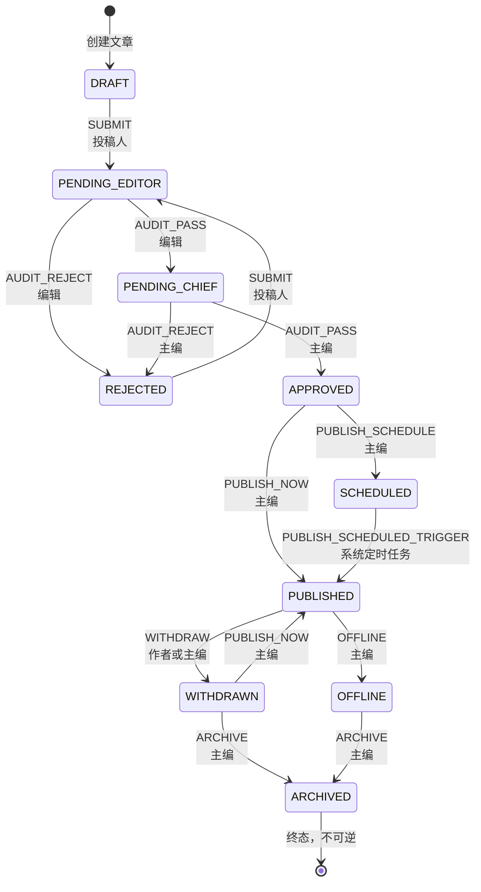
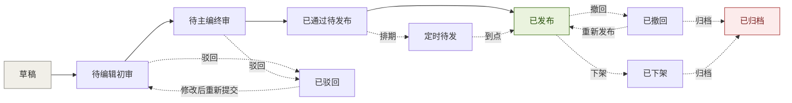

# 文章状态机设计

> 业务域一 · 文章内容与多级审核发布　负责人：成员A
> 对应代码：`com.lab.cms.util.ArticleStateMachine`、`com.lab.cms.common.enums.ArticleStatusEnum`
> 版本：V1.0　编制日期：2026-10-05

---

## 一、为什么需要状态机

文章的流转规则如果散落在各个 `if-else` 里，会立刻出现三个问题：

1. **规则不一致** —— 提交初审的接口允许"已发布"直接提交，发布接口却不允许，两处判断各写各的
2. **无法穷举验证** —— 没人能说清"到底有几种合法流转"，测试也就无法覆盖完整
3. **改一处漏三处** —— 业务规则调整时要全文搜索状态判断，必然遗漏

因此本项目把**全部流转规则集中登记在一张静态映射表**里，对外只暴露三个方法：

```java
boolean canTransfer(Integer from, ArticleAction action)   // 判断是否合法
Integer nextStatus(Integer from, ArticleAction action)     // 取目标状态，非法返回 null
void    assertTransfer(Integer from, ArticleAction action) // 非法直接抛业务异常
```

任何一处业务代码需要流转状态时，**必须**调用 `assertTransfer`，禁止自行判断状态值。

---

## 二、状态定义（10 态）

| 编码 | 枚举名 | 中文名 | 含义 | 是否终态 |
|---|---|---|---|---|
| 0 | `DRAFT` | 草稿 | 已创建但未提交，仅作者可见可编辑 | 否 |
| 1 | `PENDING_EDITOR` | 待编辑初审 | 已提交，等待编辑初审 | 否 |
| 2 | `PENDING_CHIEF` | 待主编终审 | 编辑初审通过，等待主编终审 | 否 |
| 3 | `APPROVED` | 已通过待发布 | 两级审核通过，等待发布 | 否 |
| 4 | `REJECTED` | 已驳回 | 任一级审核驳回，退回作者修改 | 否 |
| 5 | `PUBLISHED` | 已发布 | 已对外发布 | 否 |
| 6 | `SCHEDULED` | 定时待发 | 已排期，等待到点自动发布 | 否 |
| 7 | `WITHDRAWN` | 已撤回 | 已发布后被撤回，可再次发布 | 否 |
| 8 | `OFFLINE` | 已下架 | 因内容问题被运营下架 | 否 |
| 9 | `ARCHIVED` | 已归档 | 内容生命周期结束 | **是** |

---

## 三、动作定义（9 个）

| 动作 | 枚举名 | 中文名 | 触发者 |
|---|---|---|---|
| 提交 | `SUBMIT` | 提交初审 | 投稿人 |
| 审核通过 | `AUDIT_PASS` | 审核通过 | 编辑 / 主编 |
| 审核驳回 | `AUDIT_REJECT` | 审核驳回 | 编辑 / 主编 |
| 立即发布 | `PUBLISH_NOW` | 立即发布 | 主编 |
| 排期发布 | `PUBLISH_SCHEDULE` | 排期发布 | 主编 |
| 定时触发 | `PUBLISH_SCHEDULED_TRIGGER` | 排期到点 | 系统定时任务 |
| 撤回 | `WITHDRAW` | 撤回 | 作者 / 主编 |
| 下架 | `OFFLINE` | 下架 | 主编 |
| 归档 | `ARCHIVE` | 归档 | 主编 |

---

## 四、状态机图



### 4.1 主链路示意



---

## 五、状态迁移合法性矩阵

表头为**当前状态**，表体为**目标状态**；`—` 表示该动作在此状态下非法。

| 当前状态 ＼ 动作 | SUBMIT | AUDIT_PASS | AUDIT_REJECT | PUBLISH_NOW | PUBLISH_SCHEDULE | SCHEDULED_TRIGGER | WITHDRAW | OFFLINE | ARCHIVE |
|---|---|---|---|---|---|---|---|---|---|
| **DRAFT(0)** | PENDING_EDITOR | — | — | — | — | — | — | — | — |
| **PENDING_EDITOR(1)** | — | PENDING_CHIEF | REJECTED | — | — | — | — | — | — |
| **PENDING_CHIEF(2)** | — | APPROVED | REJECTED | — | — | — | — | — | — |
| **APPROVED(3)** | — | — | — | PUBLISHED | SCHEDULED | — | — | — | — |
| **REJECTED(4)** | PENDING_EDITOR | — | — | — | — | — | — | — | — |
| **PUBLISHED(5)** | — | — | — | — | — | — | WITHDRAWN | OFFLINE | — |
| **SCHEDULED(6)** | — | — | — | — | — | PUBLISHED | — | — | — |
| **WITHDRAWN(7)** | — | — | — | PUBLISHED | — | — | — | — | ARCHIVED |
| **OFFLINE(8)** | — | — | — | — | — | — | — | — | ARCHIVED |
| **ARCHIVED(9)** | — | — | — | — | — | — | — | — | — |

### 5.1 矩阵校验

| 校验项 | 结果 |
|---|---|
| 合法迁移总数 | **14 条**（与设计一致） |
| ARCHIVED 出发的迁移数 | **0 条** ✓ 终态成立 |
| 入度为 0 的状态 | 仅 `DRAFT`（由创建文章产生）✓ 入口唯一 |
| 出度为 0 的状态 | 仅 `ARCHIVED` ✓ 出口唯一 |
| 是否存在自环 | 无 ✓ |
| 是否所有状态都可达 | 10 个状态全部可达 ✓ |

### 5.2 14 条合法迁移明细（代码登记的权威清单）

| # | 当前状态 | 动作 | 目标状态 | 备注 |
|---|---|---|---|---|
| 1 | DRAFT(0) | SUBMIT | PENDING_EDITOR(1) | 投稿人提交 |
| 2 | PENDING_EDITOR(1) | AUDIT_PASS | PENDING_CHIEF(2) | 编辑初审通过 |
| 3 | PENDING_EDITOR(1) | AUDIT_REJECT | REJECTED(4) | 编辑驳回，须填意见 |
| 4 | PENDING_CHIEF(2) | AUDIT_PASS | APPROVED(3) | 主编终审通过 |
| 5 | PENDING_CHIEF(2) | AUDIT_REJECT | REJECTED(4) | 主编驳回，须填意见 |
| 6 | APPROVED(3) | PUBLISH_NOW | PUBLISHED(5) | 立即发布 |
| 7 | APPROVED(3) | PUBLISH_SCHEDULE | SCHEDULED(6) | 排期发布 |
| 8 | SCHEDULED(6) | PUBLISH_SCHEDULED_TRIGGER | PUBLISHED(5) | 定时任务触发 |
| 9 | PUBLISHED(5) | WITHDRAW | WITHDRAWN(7) | 撤回，可再发布 |
| 10 | PUBLISHED(5) | OFFLINE | OFFLINE(8) | 下架，须填原因 |
| 11 | WITHDRAWN(7) | PUBLISH_NOW | PUBLISHED(5) | 撤回后重新发布 |
| 12 | WITHDRAWN(7) | ARCHIVE | ARCHIVED(9) | 撤回后归档 |
| 13 | OFFLINE(8) | ARCHIVE | ARCHIVED(9) | 下架后归档 |
| 14 | REJECTED(4) | SUBMIT | PENDING_EDITOR(1) | 驳回后改完重新提交 |

---

## 六、必须被拦截的非法流转（测试用例来源）

以下是最容易被漏掉、也最能体现状态机价值的非法组合：

| # | 非法流转 | 为什么必须拦 | 期望返回 |
|---|---|---|---|
| 1 | DRAFT → 直接发布 | 跳过两级审核，审核机制形同虚设 | 11003 状态不允许该操作 |
| 2 | DRAFT → 直接归档 | 未经过任何流程，无归档意义 | 11003 |
| 3 | PENDING_EDITOR → 直接发布 | 未完成审核 | 11003 |
| 4 | PENDING_EDITOR → 主编终审通过 | 跨级审核，跳过初审 | 11003 |
| 5 | PENDING_CHIEF → 再次初审通过 | 重复审核，会产生重复流水 | 11003 |
| 6 | APPROVED → 撤回 | 尚未发布，无"撤回"语义 | 11003 |
| 7 | PUBLISHED → 提交初审 | 已发布内容不能回到审核链 | 11003 |
| 8 | PUBLISHED → 归档 | 必须先撤回或下架，保留中间态可追溯 | 11003 |
| 9 | ARCHIVED → 任意动作 | 终态不可逆 | 11010 已归档文章不可再编辑 |
| 10 | 已驳回 → 直接发布 | 未重新走审核 | 11003 |
| 11 | 重复提交（同状态连续两次 SUBMIT） | 产生重复待审任务 | 11006 请勿重复提交 |
| 12 | SCHEDULED → 手动发布 | 排期已占用，避免重复发布 | 11003 |

---

## 七、状态与字段的联动

状态变更时，以下字段必须同步维护，否则会出现数据不一致：

| 状态变更为 | 需同步维护的字段 |
|---|---|
| PUBLISHED | `publish_time` = 当前时间；`publisher_id` = 操作人（定时任务触发时记为系统） |
| SCHEDULED | `schedule_time` = 排期时间 |
| 任意流转 | `update_time`、`update_by` 由 `MetaObjectHandler` 自动填充 |
| 编辑 / 驳回 / 重新提交 | 每次内容变更新增一条 `cms_article_version` 快照 |

**特别注意**：`SCHEDULED` 状态回到 `PUBLISHED` 后，`schedule_time` 保留作为历史痕迹，不清空。

---

## 八、审核流水与状态的对应关系

每次 `AUDIT_PASS` 或 `AUDIT_REJECT` 都必须写入一条 `cms_article_audit_log`，且**两者必须处于同一事务**。

| 审核环节 | audit_stage | 触发状态 | 通过后 | 驳回后 |
|---|---|---|---|---|
| 编辑初审 | 1 | PENDING_EDITOR | PENDING_CHIEF | REJECTED |
| 主编终审 | 2 | PENDING_CHIEF | APPROVED | REJECTED |

**约束**：
1. `audit_stage` 必须与当前状态匹配，不匹配视为状态冲突（11003）
2. 驳回时 `opinion` 不能为空（11005），通过时允许为空
3. 流水记录 `article_version` 字段，指向审核时对应的文章版本号，便于追溯"审的是哪一版"

### 8.1 一条典型的完整链路

```
创建草稿           → DRAFT            流水 0 条
提交               → PENDING_EDITOR   流水 0 条
编辑驳回           → REJECTED         流水 1 条（stage=1, result=2, 有意见）
改稿重新提交       → PENDING_EDITOR   流水 1 条（版本号 +1）
编辑通过           → PENDING_CHIEF    流水 2 条（stage=1, result=1）
主编驳回           → REJECTED         流水 3 条（stage=2, result=2, 有意见）
改稿重新提交       → PENDING_EDITOR   流水 3 条（版本号 +1）
编辑通过           → PENDING_CHIEF    流水 4 条
主编通过           → APPROVED         流水 5 条（stage=2, result=1）
```

到达 `APPROVED` 时，审核流水恰好 **5 条**。这是 M3 里程碑主链路自测的判定依据。

---

## 九、实现约束（给编码阶段的硬要求）

1. 14 条迁移**必须**登记在静态映射表中，禁止写成 `if-else` 链
2. `ArticleStateMachine` 为无状态工具类，不得注入任何 Bean，便于纯单元测试
3. 非法流转统一抛 `BusinessException(ARTICLE_STATUS_ILLEGAL)`，不得抛 `RuntimeException`
4. `nextStatus` 对非法流转返回 `null` 而不抛异常，供"判断"场景使用
5. 传入 `null` 状态或未定义的编码（如 99）时不得抛 `NullPointerException`
6. 业务代码中禁止出现 `article.getStatus() == 5` 这类裸数字比较，一律用 `ArticleStatusEnum`
