# 系统用例图与角色分析

> 版本：V1.0　编制日期：2026-10-05　编制：成员A
> 对应评分表要求：独立撰写需求分析，界定 CMS 核心业务场景

---

## 一、总体用例图

```mermaid
flowchart TB
    subgraph actors["参与角色"]
        AU["投稿人"]
        ED["编辑"]
        CH["主编"]
        AD["管理员"]
    end

    subgraph sys["企业级 CMS 内容管理系统"]
        direction TB
        subgraph d1["业务域一 · 文章内容与多级审核发布"]
            U1["撰写与编辑稿件"]
            U2["提交审核"]
            U3["编辑初审"]
            U4["主编终审"]
            U5["发布 / 撤回 / 下架 / 归档"]
            U6["版本回滚"]
            U7["文章检索与详情"]
        end
        subgraph d2["业务域二 · 内容分类与标签体系"]
            U8["分类维护与申请"]
            U9["分类审批"]
            U10["标签维护与打标"]
        end
        subgraph d3["业务域三 · 用户角色权限与授权审批"]
            U11["注册 / 登录 / 退出"]
            U12["用户管理"]
            U13["角色与权限管理"]
            U14["授权审批"]
        end
        subgraph d4["业务域四 · 操作日志审计与数据检索统计"]
            U15["日志审计查询"]
            U16["统计报表"]
            U17["异常告警处理"]
        end
    end

    AU --> U1 & U2 & U7
    AU -.-> U8
    ED --> U3 & U4 & U7
    CH --> U4 & U5 & U6 & U7
    CH -.-> U8
    AD --> U9 & U12 & U13 & U14 & U15 & U16 & U17
    AU --> U11
    ED --> U11
    CH --> U11
    AD --> U11

    style d1 fill:#E6F1FB,stroke:#185FA5,color:#0C447C
    style d2 fill:#EAF3DE,stroke:#3B6D11,color:#27500A
    style d3 fill:#EEEDFE,stroke:#534AB7,color:#3C3489
    style d4 fill:#E1F5EE,stroke:#0F6E56,color:#085041
```

## 二、角色与用例的权限矩阵

`●` = 完整权限　`◐` = 部分权限（受限范围）　`○` = 无权限

| 用例 | 投稿人 | 编辑 | 主编 | 管理员 |
|---|---|---|---|---|
| 撰写与编辑稿件 | ● 仅自己 | ○ | ○ | ○ |
| 提交审核 | ● 仅自己 | ○ | ○ | ○ |
| 编辑初审 | ○ | ● | ○ | ○ |
| 主编终审 | ○ | ○ | ● | ○ |
| 发布 / 撤回 / 下架 / 归档 | ◐ 可撤回自己的 | ○ | ● | ● |
| 版本回滚 | ◐ 仅自己 | ○ | ● | ○ |
| 文章检索与详情 | ● | ● | ● | ● |
| 分类维护与申请 | ◐ 可申请 | ◐ 可申请 | ◐ 可申请 | ● |
| 分类审批 | ○ | ○ | ○ | ● |
| 标签维护与打标 | ◐ 仅打标 | ● | ● | ● |
| 注册 / 登录 / 退出 | ● | ● | ● | ● |
| 用户管理 | ○ | ○ | ○ | ● |
| 角色与权限管理 | ○ | ○ | ○ | ● |
| 授权审批 | ○ | ○ | ○ | ● |
| 日志审计查询 | ○ | ○ | ◐ 仅自己相关 | ● |
| 统计报表 | ○ | ○ | ◐ | ● |
| 异常告警处理 | ○ | ○ | ○ | ● |

---

## 三、核心用例详述

### 3.1 UC-01 投稿人提交审核

| 项 | 内容 |
|---|---|
| **用例名** | 提交审核 |
| **参与者** | 投稿人 |
| **前置条件** | 已登录；文章处于「草稿」或「已驳回」状态；文章为本人创建 |
| **基本流程** | 1. 投稿人在列表选择草稿，点击「提交初审」 2. 系统校验登录态与文章归属 3. 系统校验标题、正文、分类是否齐全 4. 状态机校验 `DRAFT/REJECTED + SUBMIT` 是否合法 5. 状态变更为「待编辑初审」，提示成功 |
| **异常流程** | 文章不存在 → 11001 非本人文章 → 11004 状态不允许 → 11003 已提交过 → 11006 标题或正文为空 → 11002 |
| **后置条件** | 文章状态 = `PENDING_EDITOR`，进入编辑的待办列表 |

### 3.2 UC-02 编辑初审

| 项 | 内容 |
|---|---|
| **用例名** | 编辑初审 |
| **参与者** | 编辑（需 `article:audit` 权限） |
| **前置条件** | 文章处于「待编辑初审」状态；审核人不是该文章作者 |
| **基本流程** | 1. 编辑打开审核工作台，查看文章内容与历史流水 2. 选择「通过」或「驳回」 3. 驳回时填写审核意见 4. 系统校验状态与环节匹配、意见非空 5. 状态机推进状态 6. 写入审核流水，记录环节、审核人、结论、意见、版本号 |
| **异常流程** | 环节与状态不匹配 → 11003 驳回未填意见 → 11005 审核自己提交的文章 → 11004 |
| **后置条件** | 通过 → 状态 = `PENDING_CHIEF`，进入主编待办 驳回 → 状态 = `REJECTED`，退回作者；两种情况均新增 1 条审核流水 |

### 3.3 UC-03 主编终审并发布

| 项 | 内容 |
|---|---|
| **用例名** | 主编终审并发布 |
| **参与者** | 主编（需 `article:audit` + `article:publish` 权限） |
| **前置条件** | 文章处于「待主编终审」状态 |
| **基本流程** | 1. 主编在待办中打开文章 2. 选择通过或驳回（驳回须填意见） 3. 通过后文章进入「已通过待发布」 4. 主编可选择「立即发布」或「排期发布」 5. 立即发布：写发布时间与发布人，状态 → 已发布 6. 排期发布：写排期时间，状态 → 定时待发，到点由定时任务发布 |
| **异常流程** | 排期时间早于当前时间 → 11008 未通过审核直接发布 → 11007 状态不允许 → 11003 |
| **后置条件** | 状态 = `PUBLISHED` 或 `SCHEDULED`；已发布文章同步更新检索索引，并记录操作日志 |

### 3.4 UC-04 分类变更审批

| 项 | 内容 |
|---|---|
| **用例名** | 分类变更审批 |
| **参与者** | 管理员（提交方为投稿人 / 编辑 / 主编） |
| **前置条件** | 已提交分类新增或变更申请 |
| **基本流程** | 1. 申请人提交分类新增/变更申请 2. 分类进入待审批状态，不直接生效 3. 管理员查看申请内容并给出审批结论 4. 通过则启用分类并落库；驳回则退回并记录意见 5. 每次审批写入 `cms_category_audit_log` |
| **异常流程** | 分类名重复 → 12101 存在子分类时删除 → 12102 有文章占用时停用 → 12103 |
| **后置条件** | 分类状态更新；审批留痕可追溯 |

### 3.5 UC-05 授权审批

| 项 | 内容 |
|---|---|
| **用例名** | 角色申请与权限变更审批 |
| **参与者** | 申请人（任意角色）、审批人（管理员） |
| **前置条件** | 已登录 |
| **基本流程** | 1. 申请人提交角色申请单或权限变更申请 2. 申请单进入待审批状态 3. 管理员查看申请内容并审批 4. 通过则将角色/权限落库并生效 5. 驳回则退回并记录意见 |
| **异常流程** | 重复提交相同申请 → 13101 申请不存在的角色 → 13102 |
| **后置条件** | 授权生效或明确驳回；全过程留痕 |

### 3.6 UC-06 数据检索与日志审计

| 项 | 内容 |
|---|---|
| **用例名** | 文章综合检索与日志审计 |
| **参与者** | 主编、管理员 |
| **前置条件** | 已登录且具备相应权限 |
| **基本流程** | 1. 用户输入检索条件（关键词、分类、标签、状态、时间范围） 2. 系统执行多条件组合检索并分页返回 3. 管理员可按模块、操作人、时间、结果查询操作日志 4. 可按账号与时间范围查询登录日志 5. 生成统计报表（状态分布、分类分布、审核效率） |
| **异常流程** | 分页参数非法 → 400（截断或回落默认值） 检索范围过大 → size 上限 100 保护 |
| **后置条件** | 返回结果集；查询动作本身也记录操作日志 |

---

## 四、用例与业务域的归属汇总

| 业务域 | 用例编号 | 用例名 | 主责 |
|---|---|---|---|
| 一 | UC-01 | 投稿人提交审核 | 成员A |
| 一 | UC-02 | 编辑初审 | 成员A |
| 一 | UC-03 | 主编终审并发布 | 成员A |
| 一 | — | 版本管理与回滚 | 成员A |
| 二 | UC-04 | 分类变更审批 | 成员B |
| 二 | — | 标签维护与文章打标 | 成员B |
| 三 | UC-05 | 授权审批 | 成员C |
| 三 | — | 用户注册 / 登录 / 退出 | 成员C（公共基础设施） |
| 三 | — | 角色与权限管理 | 成员C |
| 四 | UC-06 | 文章综合检索与日志审计 | 成员D |
| 四 | — | 统计报表与导出 | 成员D |
