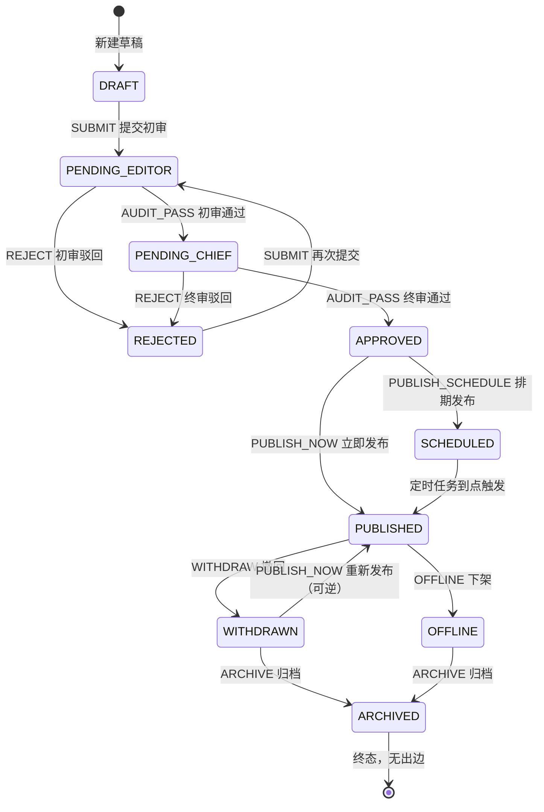
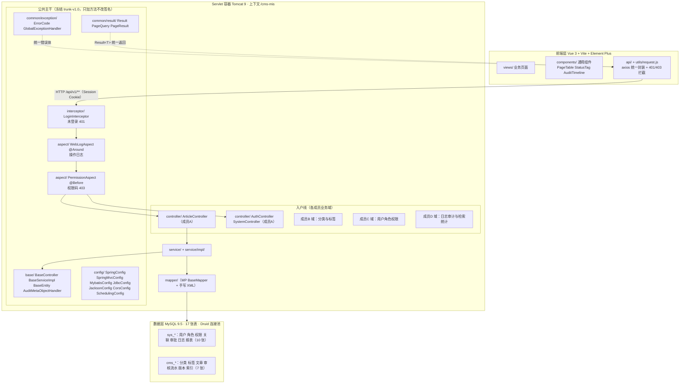
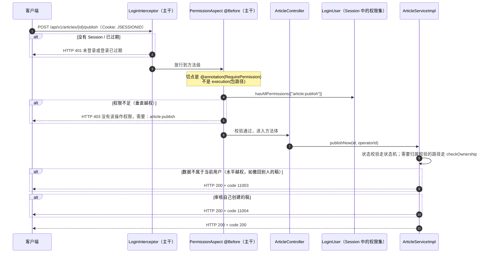
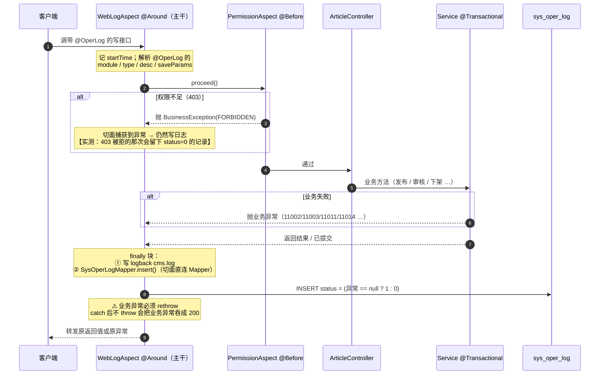
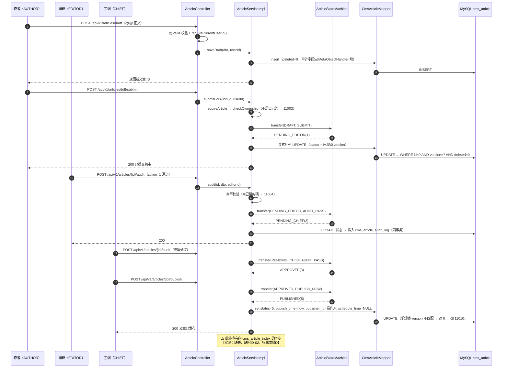

# 结题报告 · 企业级 CMS 内容管理系统

> 课程：《JAVA框架技术（一）》课程项目设计 · 总分 20 分
> 项目：基于实验二 SSM 整合升级 · 企业级 CMS 内容管理系统
> 形式：4 人小组 · 本文档由组长（成员A）统稿
> 日期：2026-11-09 ~ 11-10（第 26~27 天）编制 · **2026-11-13（第 30 天）S24 复核修订** · 手册步骤：S21 · WBS A-11
> 工程：`D:/mybatis-demo/project1` · 提交 **36 条** · 标签 **8 个**（均为 S24 后实查值）

> 📌 **S24 修订说明**：本文档初稿写于 S21，之后做了 S24 自选加分交付（分类/标签/日志/报表四域 20 个端点、
> 分支合并痕迹）。本版把文中所有"当前规模"类数字（端点数、测试用例数、文档份数、提交条数、标签数）
> **按 S24 后的实查值更新**；历史语境里的数字（如"S20 那次回归 321 条"）保留并标注时间。

> ⚠️ **本文档的写法说明**
> 1. 所有技术论断都带**实测依据**（文件行号、命令输出、库表查询结果），不写"功能强大""界面美观"这类话。
> 2. **没有实现的部分一律标 `[待补充]` 并写明原因**，不粉饰（例：前端富文本编辑器只做了纯文本域）。
> 3. 四个业务域中，**文章域（成员A）详写**；另外三个域留 `[成员B 填写]` / `[成员C 填写]` / `[成员D 填写]`
>    占位，四节结构完全一致，方便分发后合并。
> 4. 文中提到的"手册"指 `成员A-开发提示词手册.md`，**手册与代码冲突时以代码与库表为准**，
>    差异逐条登记在 `docs/接口清单.md` §六、`docs/回归测试报告.md` §一。

---

## 一、项目概述

### 1.1 背景

实验二完成了 Spring + SpringMVC + MyBatis 的"能跑通"级整合，但业务上只有一个 User 单表 CRUD，
没有状态流转、没有权限体系、没有审计。本项目在这套骨架上做**企业级升级**：把 CMS（内容管理系统）
作为业务载体，要求"多角色 + 多状态 + 全留痕"，并且**四人并行开发**同一份代码。

### 1.2 目标

| 目标 | 可验收的判据 |
|---|---|
| 业务闭环 | 文章从投稿到发布/下架/归档的**10 状态 14 条迁移**全部可实测走通 |
| 权限闭环 | 垂直越权（403）、水平越权（11003）、自审（11004）三类**都能被拦住且拦在正确的位置** |
| 审计闭环 | 每一次写操作留操作日志，每一次登录（成功与失败）留登录日志 |
| 工程质量 | 主干冻结后只加方法不改签名；17 张表统一审计字段与逻辑删除 |
| 可交付 | 干净的部署流程 + 一份能照着跑起来的部署文档 + 验收自测表 |

### 1.3 范围（明确写了不做什么）

**做**：文章域全生命周期（草稿→提交→两级审核→发布/排期→撤回/下架/归档→版本快照与回滚→逻辑删除）、
统一返回体与错误码、AOP 权限校验、操作日志与登录日志、全局异常处理、参数校验基座、
列表分页与多条件检索、前端文章管理页 6 个页面。

**不做（并在文档中注明）**：

| 不做的事 | 原因 |
|---|---|
| 富文本编辑器（只做 `textarea` 纯文本域） | 引入富文本会带出 XSS 过滤、图片上传、粘贴清洗一整条链路，超出课程范围；**已在 `ArticleEdit.vue` 里注明** |
| 检索索引表 `cms_article_index` 的写入 | 属成员D 检索域（**缺陷 D-02**，已给对接契约，见 §4.5） |
| 全文检索、ES | 中文全文检索要 ngram 分词器；上 ES 属于手册明令禁止的过度设计 |
| 物理删除接口 | 交付口径是逻辑删除（留档优先），物理清理只走 SQL 脚本 |
| 前端其余三个业务域的页面 | 分属成员B/C/D；本工程为它们准备了 `views/placeholder` 占位页 |

---

## 二、需求分析

### 2.1 角色与权限模型（RBAC）

四个角色，权限码共 20 条（库表 `sys_permission` 为**唯一真相**），文章域占 9 条。

| 角色 | ID | 权限码数 | 关键能力 |
|---|---|---|---|
| 投稿人 AUTHOR | 7 | 7 | 建/改/提交/撤回/删除**自己的**文章 |
| 编辑 EDITOR | 9 | 9 | 投稿人能力 + **初审**（`article:audit`） |
| 主编 CHIEF | 12 | 12 | 编辑能力 + **发布**（`article:publish`）+ **下架/归档**（`article:manage`）+ 报表查看 |
| 管理员 ADMIN | 20 | 20 | 全部 |

> ⚠️ **两级审核共用同一个接口** `POST /articles/{id}/audit`，由**当前状态**决定这是初审还是终审
> （`1`→`2` 是初审，`2`→`3` 是终审）。这样做的好处是客户端不需要知道"我现在是在做哪一级审核"。

### 2.2 核心业务场景（评分表点名的七个）

| 场景 | 本项目的实现落点 |
|---|---|
| 文章发布 | `cms_article` 状态机 + 立即发布/排期发布两条路径 |
| 分类 | `cms_category` + `cms_category_audit_log`（**成员B 域**） |
| 审核 | 两级审核 + `cms_article_audit_log` 流水 |
| 用户管理 | `sys_user` + `sys_user_role`（**成员C 域**） |
| 权限管控 | `@RequirePermission` 注解 + `PermissionAspect` 切面 + 归属校验 |
| 数据检索 | 列表多条件分页检索（成员A 已实现）+ `cms_article_index`（**成员D 域，D-02 待接**） |
| 日志记录 | `sys_oper_log`（AOP 切面）+ `sys_login_log` |

### 2.3 文章状态机（本项目的业务核心）

10 个状态、14 条合法迁移，全部集中在 `com.lab.cms.common.ArticleStateMachine`：



**三条必须记住的规则**（都踩过）：

1. **`OFFLINE(8)` 只有 `ARCHIVE` 一条出边** —— 已下架**不能**重新发布，下架不可逆；而 `WITHDRAWN(7)` 可以再发布，撤回可逆。
   > 手册 F06 与 S14 都写"已下架可以重新发布"，**与实现不符**。项目按代码执行，差异已登记。
2. **`SCHEDULED(6)` 没有人工出边** —— 只有定时任务能把它推到 `PUBLISHED(5)`。
3. **`ARCHIVED(9)` 是终态** —— 此后任何写操作返回 `11011`。

---

## 三、系统设计

### 3.1 总体架构与"主干 / 入户线"的边界

本项目把代码分成两块：**主干**（四人共用，冻结后只加方法）与**入户线**（各自业务域，互不越界）。
这条边界是四人并行开发能不出事的关键。



**边界规则（写进 `docs/工程骨架与配置说明.md`）**：

- 主干包 = `config / common / base / annotation / aspect / interceptor / util`。
- 主干在 S08 自测 13 项通过后**冻结**，标签 `trunk-v1.0`（第 10 天）；
  此后任何人**只能往主干加方法，不能改已有方法的签名**。
- 业务代码只写在 `controller / service / mapper / entity / dto / vo` 各自的包里，**不往主干塞业务**。
- 验收方式：S19/S20 对主干的改动全部是"新增方法"（如 `SpringMvcConfig#addFormatters`、
  `#addViewControllers`），自检项 **5-4** 专门核这一条。

### 3.2 分层设计

| 层 | 职责 | 约束 |
|---|---|---|
| `controller` | 收参数、取当前用户、返回 `Result` | **不含业务判断**（自检 1-4）；类超 500 行即不合格（自检 1-9，`ArticleController` 恰好 500 行） |
| `service` / `impl` | 业务规则、状态流转、事务边界 | 状态判断一律走状态机；改动多字段时必须显式列列（见 §5.2） |
| `mapper` | 数据访问 | `BaseMapper<T>` 提供 CRUD；复杂检索用手写 XML，**必须自己写 `AND deleted = 0`** |
| `entity` | 表映射 | 全部继承 `BaseEntity`（主键 + 审计四字段 + 逻辑删除） |
| `dto` / `vo` | 入参 / 出参 | 入参用 `@Valid` 校验；**出参一律用 VO，不直接返回 Entity** |

### 3.3 数据库设计

**17 张表**（手册 §2.3 的硬约束是"六表关联、杜绝单表开发"，本项目做到 17 张）。
全部统一：`id` 主键（`BIGINT AUTO_INCREMENT`）+ 审计四字段（`create_by/create_time/update_by/update_time`）
+ 逻辑删除 `deleted`。

| 域 | 表名 | 用途 |
|---|---|---|
| 用户角色权限（成员C） | `sys_user` | 用户表 |
| | `sys_role` | 角色表 |
| | `sys_permission` | 权限表（20 条权限码，文章域 9 条） |
| | `sys_user_role` | 用户角色关联表 |
| | `sys_role_permission` | 角色权限关联表 |
| | `sys_apply_approval` | 授权申请审批表 |
| 分类标签（成员B） | `cms_category` | 内容分类表（多级） |
| | `cms_category_audit_log` | 分类审批流水表 |
| | `cms_tag` | 标签表 |
| | `cms_article_tag` | 文章标签关联表 |
| 文章（成员A） | `cms_article` | 文章主表（状态机主体） |
| | `cms_article_audit_log` | 文章审核流水表 |
| | `cms_article_version` | 文章版本快照表 |
| 日志审计检索（成员D） | `sys_oper_log` | 操作日志表 |
| | `sys_login_log` | 登录日志表 |
| | `cms_article_index` | 文章检索索引表（**D-02：暂无写入代码**） |
| | `sys_report` | 统计报表表 |

> ⚠️ 手册 S22 写"验证 **14 张**表都建出来了"，**实际是 17 张**。以 `sql/init.sql` 为准（差异已登记）。
>
> E-R 图见 `docs/数据库设计.md`；建表脚本 `sql/init.sql`（含 20 篇种子文章、5 个测试账号）。

**设计取舍（每条都有理由，不是照抄）**：

| 取舍 | 理由 |
|---|---|
| 主键用 `IdType.AUTO` 而非 MP 的雪花 ID（`ASSIGN_ID`） | 雪花 ID 是 19 位 long，**超出 JS Number 安全范围**（15~16 位），前端会丢精度，id 变成 `xxx000` 这种巧合值 |
| `@TableLogic` **显式**写 `value="0", delval="1"` | MP 默认值虽是 0/1，但业务上"1=有效/0=无效"的习惯很常见，方向相反；不显式声明读代码的人极易理解反 |
| 逻辑删除 + **唯一索引**的冲突 | 唯一键残留问题已登记（见 §7.2 不足） |
| 审计字段由 Java 侧 `MetaObjectHandler` 填，不靠数据库 `DEFAULT CURRENT_TIMESTAMP` | 数据库只能填"时间"，填不了"**谁**改的"，而审计的核心恰恰是"谁" |

### 3.4 接口规范

- 前缀统一 `/api/v1/`，资源名用复数（`/articles`）。
- **动作式 URL** 而非状态字段：`POST /articles/{id}/submit`，不是 `PUT /articles/{id}/status`。
  这样客户端**无法直接指定目标状态**，目标状态由状态机决定 —— 从接口形态上就杜绝了"客户端自己跳到已发布"。
- 统一返回体 `Result<T>{code,message,data,timestamp}`，成功 `message` 固定「操作成功」。
- **双层错误码**：`100~599` 同步 HTTP 状态；业务码 `10xxx~14xxx` **保持 HTTP 200**。
- 认证用 **Session（Cookie）**，不是 Bearer Token。
- 分页参数统一 `PageQuery`：`size` 上限 **100**；非法 `sortField` 直接 **400**（防排序注入）。

完整清单（**48 个端点**、逐条与代码核对）见 **`docs/接口清单.md`**（S23 交付时 28 个，S24 加分交付新增分类/标签/日志/报表四域 20 个）。

### 3.5 主干的另外两条链路（鉴权 / 日志）

这两条链路的**执行顺序是实测定下来的**，不是照设计写的 —— 两个切面套在同一个方法上，
代码里**没有写 `@Order`**，谁在外层只能靠实测判定。

**① 鉴权链路：拦截器（401）→ AOP 权限切面（403）→ Service 归属校验（11003/11004）**



**三级职责分属三个地方，报错形态完全不同**（这是排查时最容易误判的一点）：

| 失败形态 | 谁出的 | 性质 |
|---|---|---|
| **HTTP 401** | `LoginInterceptor`（主干） | 没登录 |
| **HTTP 403** | `PermissionAspect`（主干，`@Before`） | 登录了但缺权限码 |
| **HTTP 200 + 11003** | Service 的 `checkOwnership` | 有权限，但数据不是自己的 |
| **HTTP 200 + 11004** | Service 的自审校验 | 有权限，但不能审自己的稿 |

**② 日志链路：`@Around` 切面 → `sys_oper_log`**



**实测定下来的四条结论**（凭读代码说不准，必须实测）：

| 核对点 | 实测结果 |
|---|---|
| 403 被拒的写操作记不记日志 | **记**（说明**日志切面在权限切面之外**） |
| `@Valid` 校验失败（400）记不记 | **不记**（参数校验在方法被调用之前完成，切面根本没进） |
| Service 方法体内抛的 400 记不记 | **记**（异常从方法体抛出，切面抓到了）<br/>—— **同样是 400，一个留痕一个不留痕** |
| `response_result` 能不能判断成败 | **不能**。全库恒为 NULL（`saveResult()` 默认 false），**判成败只看 `status` 列** |

> ⚠️ 日志写入走的是**切面直连 `SysOperLogMapper`**（全项目唯一一处"切面直连 Mapper"的分层例外），
> 而不是走带 `@Transactional` 的 Service —— 否则业务回滚会把"失败日志"一起回滚掉，
> 而失败日志恰恰是回滚时最需要留下的东西。（这条坑在 S20 以另一种形式真的踩到了：见 §5.7 的 D-10。）

---

## 四、详细实现

> 四个业务域章节结构一致：**业务流程 → 关键类清单 → 核心代码要点 → 接口清单**。

### 4.1 业务域一：文章内容与多级审核发布（成员A，详写）

#### 4.1.1 业务流程（跨 Controller / Service / Mapper 全链路）



#### 4.1.2 关键类清单

| 类 | 行数 | 职责 |
|---|---|---|
| `controller/ArticleController` | 500 | 16 个端点的入口，只做参数与当前用户传递 |
| `service/ArticleService` | 778 | 接口 + 全部契约 Javadoc（含每个取舍的理由） |
| `service/impl/ArticleServiceImpl` | 2239 | 文章域全部业务逻辑：状态推进、归属校验、版本快照、批量容错 |
| `service/impl/LoginLogServiceImpl` | 68 | 登录日志独立事务（`REQUIRES_NEW`），S20 新增 |
| `common/ArticleStateMachine` | 383 | 10 态 14 迁移的静态映射表 + `transfer/assertTransfer` |
| `common/enums/ArticleStatus` / `ArticleAction` | —— | 状态与动作枚举，含 `description`（如 `SUBMIT` = 「提交初审」） |
| `task/ArticlePublishScheduler` | —— | 排期发布定时任务（cron `0 * * * * ?`） |
| `dto/`（7 个） | —— | `CmsArticleSaveDTO` / `CmsArticleQueryDTO` / `ArticleAuditDTO` / `BatchSubmitDTO` / `CmsArticlePublishDTO` / `CmsArticleOfflineDTO` / `CmsArticleRollbackDTO` |
| `vo/`（6 个） | —— | `CmsArticleVO` / `CmsArticleDetailVO` / `ArticleAuditLogVO` / `CmsArticleVersionVO` / `BatchSubmitResultVO` / `LoginVO` |

#### 4.1.3 核心代码要点（每一处都是踩过坑才这么写的）

**① 状态推进必须过状态机，业务代码里不写 `if (status == ...)`**

```java
// 唯一入口；状态不允许时抛 BusinessException(11002)
ArticleStatus next = ArticleStateMachine.transfer(article.getStatus(), ArticleAction.SUBMIT);
```

理由：14 条迁移如果散在 5 个方法里，改一处忘一处必然出错；集中在静态映射表后，
新增状态只需改一个地方，而且可以写一个测试把所有组合跑一遍（`ArticleStateMachineTest`，100 种组合）。

**② 归属校验（水平越权）刻意不设"超管短路"，且顺序排在归档校验之前**

```java
private void checkOwnership(CmsArticle article, Long operatorId) {
    if (!Objects.equals(article.getAuthorId(), operatorId)) {
        throw new BusinessException(ErrorCode.ARTICLE_OWNERSHIP_DENIED); // 11003
    }
}
```

由此产生一个**既定行为**：`admin` 改别人的草稿也是 `11003`，而不是"管理员放行"。
并且对**别人的已归档文章**调撤回/回滚/删除，拿到的是 `11003` 而不是 `11011` ——
因为归属层排在归档双保险之前。全项目五条路径（改草稿 / 提交 / 撤回 / 回滚 / 删除）**同序**，
这条已固化为回归断言。

**③ 哪些接口要归属校验、哪些不要（逐条读源码得出）**

| 要归属校验 | 不要（运营职能） |
|---|---|
| 改草稿、提交初审、撤回、版本回滚、删除 | 立即发布、排期发布、重新发布、下架、归档、审核（审核只判"不能审自己的稿" 11004） |

**④ 批量提交：逐条独立事务 + 有失败仍返 200**

`BatchSubmitResultVO{total, successCount, failCount, failList[{id, reason}]}`。
请求本身合法且被处理了，失败是**逐条业务规则的判定结果**，所以 HTTP 是 200；
前端必须读 `data.failList` 而不能只看状态码。

**⑤ 版本快照与回滚**

- 快照在"保存草稿"时生成，`versionNo` **只增不减**（回滚也是新建一版）。
- 版本列表**不返回正文**（只给标题快照），因为正文是 LONGTEXT，列表页不需要。
- 已发布态不能直接回滚（`11002`，须先撤回）。

**⑥ 排期发布：没有请求上下文时，审计字段照样要填对**

```mermaid
sequenceDiagram
    autonumber
    participant CRON as Spring @Scheduled<br/>cron 0 * * * * ?
    participant SCH as ArticlePublishScheduler
    participant SV as ArticleServiceImpl
    participant DB as cms_article

    CRON->>SCH: 每分钟触发 publishScheduled()
    SCH->>SV: 查 findDueScheduledArticleIds(now)
    SV->>DB: SELECT ... WHERE status=6 AND schedule_time &lt;= now AND deleted=0
    DB-->>SV: 到点的文章 ID 列表
    loop 逐篇（逐条独立事务，互不拖累）
        SV->>SV: transfer(SCHEDULED, ?) → PUBLISHED(5)
        SV->>DB: UPDATE status=5, publish_time, publisher_id=0, schedule_time=NULL
        Note over SV,DB: publisher_id = 0（SYSTEM_USER_ID）<br/>因为定时任务没有 HttpServletRequest
    end
    Note over SCH: 实测：排期 now+75s，等待 130s 后<br/>status 自动变 5、publish_time 已写、publisher_id=0
```

> ⚠️ 这条链路的坑：`MetaObjectHandler` 靠 `RequestContextHolder` 取当前用户，
> **定时任务线程里没有请求上下文** → 取不到用户。见 §5.6。

#### 4.1.4 接口清单（16 个，完整表格见 `docs/接口清单.md` §二）

| 分组 | 端点 |
|---|---|
| 草稿与提交 | `GET /articles`、`POST /articles/draft`、`PUT /articles/{id}/draft`、`POST /articles/{id}/submit`、`POST /articles/batch-submit` |
| 审核 | `POST /articles/{id}/audit`、`GET /articles/{id}/audit-logs` |
| 发布类 | `POST /articles/{id}/publish`、`POST /articles/{id}/schedule` |
| 撤回下架归档 | `POST /articles/{id}/withdraw`、`POST /articles/{id}/offline`、`POST /articles/{id}/archive` |
| 详情与版本 | `GET /articles/{id}`、`GET /articles/{id}/versions`、`POST /articles/{id}/rollback` |
| 删除 | `DELETE /articles/{id}` |

#### 4.1.5 前端文章管理页（6 个页面）

| 页面 | 作用 |
|---|---|
| `views/article/ArticleList.vue` | 列表 + 多条件筛选 + **按状态与归属动态下发操作按钮** |
| `views/article/ArticleEdit.vue` | 新建/编辑草稿（纯文本域，见 §1.3 不做列表） |
| `views/article/ArticleDetail.vue` | 详情 + 审核时间线 + 版本列表 + 回滚 |
| `views/article/ArticleAudit.vue` | 审核工作台（通过/驳回 + 意见） |
| `views/article/ArticleMine.vue` | 我的投稿 |
| `components/` | `PageTable`（列表页通用封装）、`StatusTag`（状态徽章）、`AuditTimeline`（审核时间线）、`ConfirmAction`（二次确认） |

**按钮如何下发（权限 × 状态 × 归属三个维度）**：
`articleActions.js` 里一张 `RULES[status] → 动作集` 的静态表 + 每个动作的 `perm` + `ownerOnly` 标记，
三者都满足才显示。S20 补上归属维度前，主编会在别人的草稿行看到「编辑」按钮、点下去必被 11003 拒（**缺陷 D-07**，已修）。

### 4.2 业务域二：内容分类与标签体系（成员B）

> **[成员B 填写]**
> 本节按 §4.1 的四段式结构填写：`4.2.1 业务流程`（含多级分类树与分类审批流的时序图）、
> `4.2.2 关键类清单`、`4.2.3 核心代码要点`、`4.2.4 接口清单`。
> 可引用的公共事实：`cms_category` / `cms_category_audit_log` / `cms_tag` / `cms_article_tag` 四张表；
> 前端请放在 `views/category`、`views/tag`（本工程已留 `views/placeholder` 占位页与侧边栏入口）。
> 已知待办：`cms_category_audit_log.auditor_id` **未建索引**（自检 4-5）。

### 4.3 业务域三：用户角色权限与授权审批（成员C）

> **[成员C 填写]**
> 本节按 §4.1 的四段式结构填写。
> 可引用的公共事实：`sys_user` / `sys_role` / `sys_permission` / `sys_user_role` / `sys_role_permission` /
> `sys_apply_approval` 六张表；权限码共 20 条，文章域占 9 条（清单见 `docs/接口清单.md` §5.3）。
> **接口层已就绪**：`@RequirePermission` 注解与 `PermissionAspect` 切面（主干，已冻结）；
> `LoginInterceptor` 负责未登录 401；`sys_apply_approval.approver_id` 与 `target_role_id` **未建索引**（自检 4-5）。
> 已知待办：需补 `UserVO`（含脱敏）才能通过自检 3-11。

### 4.4 业务域四：操作日志审计与数据检索统计（成员D）

> **[成员D 填写]**
> 本节按 §4.1 的四段式结构填写。
> **接口层已就绪**：`@OperLog` 注解与 `WebLogAspect` 切面（主干，已冻结）——切面**直连 `SysOperLogMapper`**
> （全项目唯一一处"切面直连 Mapper"的分层例外，已在 `docs/工程骨架与配置说明.md` 登记）。
> 请务必写清：`sys_oper_log.status` 是 **1 成功 / 0 失败**，与 `sys_login_log.login_status`（**1 成功 / 2 失败**）
> **不是同一套口径**；`response_result` 恒为 NULL（`saveResult()` 默认 false），判成败**只能看 `status`**。
> 已知待办：`sys_report.generator_id` 未建索引；`cms_article_index` 无任何写入代码（**D-02**，对接契约见 §4.5）。

### 4.5 跨域待对接项：发布链路的检索索引同步（D-02）

**现状（实测）**：发布一篇文章后，`cms_article_index` 行数 `3 → 3` **不变**；
全仓没有任何代码往这张表写（`entity/`、`mapper/` 下零匹配）；
归档路径只有一个占位方法，**只打一条 INFO 日志**，不执行 UPDATE。

**给成员D 的对接契约**：

| 项 | 内容 |
|---|---|
| 触发点 | 发布路径（`publishNow` / `publishScheduled`）**以及**归档路径（改成真 UPDATE） |
| 需要字段 | `article_id, title, keywords, category_id, hot_score, index_status`（表结构已在 `sql/init.sql`） |
| 事务边界 | ⚠️ **不要用 `REQUIRES_NEW`**：文章发布是 `@Transactional` 的，若索引写入用独立事务，一旦发布随后回滚，就留下**孤儿索引**（索引里有、文章没发布）。建议放在**业务事务之外**（提交成功后同步） |
| 幂等 | 按 `article_id` 做 **UPSERT**，重试不写坏数据 |
| 验证方法 | 发布一篇 → 查索引表是否有该 `article_id`；再手工把状态改回草稿模拟回滚 → 确认索引里**不留下**这篇 |

---

## 五、关键技术难点与解决方案

> 每条按 **问题现象 / 排查过程 / 根因 / 解决方案 / 验证结果** 五段写。
> **"验证结果"必须是可复现的实测输出**，不是"已解决"。

### 5.1 Maven 运行在 JDK 25 上，Lombok 注解处理器静默失效

| 项 | 内容 |
|---|---|
| **现象** | 编译不报错，但 `@Data` 生成的 getter/setter 全部找不到，报"找不到符号"，且**没有任何关于 Lombok 的警告** |
| **排查** | ① 确认 Maven 实际用的 JDK（`mvn -version`）是 **JDK 25**，而工程 `maven.compiler.source/target` 是 21；② 换 Lombok 版本逐版试，发现 `1.18.30` 在 JDK 25 的 javac 下**不报错也不工作** |
| **根因** | JDK 23 起 javac 默认 `-proc:none`（注解处理默认关闭），且旧 Lombok 不兼容 JDK 25 的 javac 内部 API |
| **解决** | ① Lombok 升到 **1.18.48**；② 在 `maven-compiler-plugin` 显式加 `<arg>-proc:full</arg>` 打开注解处理 |
| **验证** | `pom.xml` 里可见 `<lombok.version>1.18.48</lombok.version>` 与两处 `<arg>-proc:full</arg>`；此后 `mvn -o test` 从"编译不过"变为全绿（当时 321 条；S24 后为 **390/390 全绿**） |

> 这条的教训：**"静默失效"比报错更危险**。JDK 与构建工具的版本错配经常表现为"什么都不说，就是不行"。

### 5.2 MyBatis-Plus 的 `@TableLogic` 与 `updateById` 的填充语义冲突

| 项 | 内容 |
|---|---|
| **现象** | ① 用 `updateById(entity)` 想把某字段**置空**，接口返 200，但库里**没改**；② 给 `update_time` 留 null 触发 `Column 'update_time' cannot be null` |
| **排查** | ① 打开 `logs/cms.log` 看 MP 生成的 `Preparing:` 语句 —— 发现 `SET` 子句里**根本没有那个字段**；② 看 `updateById` 生成的 SQL 与参数绑定：`update_time` 与 `update_by` 绑的都是 `null` |
| **根因** | MP 默认 `FieldStrategy.NOT_NULL`：**null 字段不参与 SET**。而 `updateById` 组装 SET 子句时会把带 `INSERT_UPDATE` 策略的列提前纳入更新列表，导致 `strictUpdateFill` 的"仅当为 null 才填"判定被绕过 |
| **解决** | ① 需要清空字段时改用**显式列列**的 `LambdaUpdateWrapper.set(...)`（如 `schedule_time` 置 NULL）；② `AuditMetaObjectHandler#updateFill` 改用 `setFieldValByName` **无条件覆盖**（更新时间本就该是本次操作时间） |
| **验证** | `base/BaseEntity.java` 与 `base/AuditMetaObjectHandler.java` 的类注释里完整记录了这两条；S18 逻辑删除与 S13/S14 的置空路径均改为此写法，回归 132 项断言全绿 |

> ⚠️ **同一个坑还有一个连带后果**：`removeById` 生成的逻辑删除 SQL，`SET` 子句**只有 `deleted = 1` 一列**，
> `update_by / update_time` 不会自动填充 → 删完之后**库里看不出是谁删的**。
> 所以 S20 补齐删除接口时用显式列列的 `LambdaUpdateWrapper`，而不是现成的 `removeById`。

### 5.3 MP 分页插件对自定义 JOIN 查询的 count 语句问题

| 项 | 内容 |
|---|---|
| **现象** | 列表接口要带 `categoryName` / `authorName`，写成 JOIN 查询后，`total` 与 `records.size()` **对不上**（多表 JOIN 放大行数） |
| **排查** | 打开 SQL 日志，发现 count 语句与主查询用了同一段 JOIN；在 20 行种子库上翻页时第一页就出现重复行 |
| **根因** | `PaginationInnerInterceptor` 对自定义 SQL 的 count 优化会简化掉 `ORDER BY`，但**去不掉 JOIN 带来的行数放大**；`left join` 一对多时 count 偏大 |
| **解决** | 改用**方案 B：主表分页 + 批量填充** —— 先只用 `cms_article` 单表分页（count 准确），拿到当页的 `categoryId/authorId` 集合后再**批量查名称回填**（避免 N+1） |
| **验证** | 真机实测：`total=20`、`records` 大小 10（第 1 页）与 20（`size=20`）；空页返回 `records=[]` 且 `total` 不变；出参含 `categoryName`/`authorName`。SQL 条数：有数据页 3~4 条 / 越界或空结果页 1 条（`continuePage()` 在 `offset >= total` 时连主查询一起跳过） |

### 5.4 状态机集中管理，避免 `if-else` 散落

| 项 | 内容 |
|---|---|
| **现象** | 早期每个业务方法里都写 `if (status == 1 || status == 4) { ... } else throw ...`，14 条迁移散在 5 个方法里 |
| **排查** | 用"新增一个状态要改几处"作为判据自测：答案是需要翻 5 个方法，且漏改不会有任何编译错误 |
| **根因** | 状态流转规则没有单一出处；`if-else` 表达的是"某方法恰好允许的状态"，而不是"状态机的全局规则" |
| **解决** | 抽 `ArticleStateMachine`：静态 `Map<String, ArticleStatus>` 存 14 条迁移，key 为 `status-action`；对外只暴露 `transfer(status, action)` / `canTransfer` / `assertTransfer`，状态不允许统一抛 `11002` |
| **验证** | ① 全仓 `ArticleServiceImpl` 里**没有任何一处** `if` 直接判断数字状态放行；② `ArticleStateMachineTest` 遍历 **100 种** status×action 组合并断言结果；③ `outDegree`/`transitionCount` 断言"`OFFLINE(8)` 出边恰好 1 条、`ARCHIVED(9)` 出边 0 条" |

### 5.5 主干冻结后四人并行开发的协作方式

| 项 | 内容 |
|---|---|
| **现象** | 四人同时改代码，最容易出的事是"我改了一个公共方法，另外三个人的功能一起挂" |
| **排查** | 在 S03 设计阶段就预判到了，因此先产出《接口契约》与《企业开发规范清单》再动手写代码 |
| **根因** | 并行开发的冲突点**不在业务代码，在公共设施**（返回体、异常码、拦截器、基类） |
| **解决** | ① **契约先行**：S03 定稿接口与规范，标签 `M1-接口契约评审通过`；② **主干先建后冻**：S04~S08 由成员A 一次性建好主干，S08 自测 13 项通过后打标签 `trunk-v1.0`，此后**只加方法不改签名**；③ 业务代码只在各自包内 |
| **验证** | 自检项 **5-4** 专门核"主干未被改签名"：S19/S20 对 `SpringMvcConfig` 的改动（`addFormatters`、`addViewControllers`）**均为新增方法**；`ApiPermissionCoverageTest` 断言文章域 9 个权限码零豁免 |

> **踩到的坑（如实记录）**：契约 §1.3 写了 `article:list` / `article:edit` / `article:offline` / `article:archive`
> 四个权限码，但**库表 `sys_permission` 里一个都没有**。照契约写会让 `PermissionAspect` 认为"所有角色都缺这个权限"，
> **连 admin 都被 403**。项目口径最终定为 **库表 > 契约**，四处全部改用库里真实存在的码（差异登记在 `docs/接口清单.md` §六）。

### 5.6 排期发布定时任务没有 `HttpServletRequest`，审计字段填充失败

| 项 | 内容 |
|---|---|
| **现象** | 定时任务发布文章时报 `Column 'create_by' cannot be null` / `Column 'update_time' cannot be null`，接口路径下同样的代码却正常 |
| **排查** | 定点单跑定时方法复现；读 `AuditMetaObjectHandler#getCurrentUserId()` 发现它走 `RequestContextHolder` 的 ThreadLocal，而**定时任务线程里没有请求上下文** |
| **根因** | 审计填充依赖请求上下文；定时任务是"系统行为"，天然没有登录用户 |
| **解决** | ① `getCurrentUserId()` 捕获异常并返回 null，**填充失败绝不影响业务**；② 拿不到用户时 `create_by/update_by` 填 `SYSTEM_USER_ID = 0`（哨兵值，语义为"系统操作"），**不留 null** —— 既避开 NOT NULL 约束，又让"系统写入"在审计里显式可见；③ `update_time` **永远填**（与有无登录用户无关） |
| **验证** | 真机实测排期 `now+75s`，等待 **130 秒**后无人干预自动发布：`status=5`、`publish_time` 已写入、**`publisher_id = 0`**、`schedule_time` 被清空；共 7 项断言全绿 |

> ⚠️ **顺带记一个陷阱**：`deleted` 列在库里虽定了 `DEFAULT 0`，但 MP 生成的 INSERT 语句
> **会把这个列列进去**并显式传 null，而 MySQL 只在"列未出现在 INSERT 列表中"时才使用 DEFAULT
> → 结果就是 `Column 'deleted' cannot be null`。所以 `deleted` 也必须在 `insertFill` 里显式填 0。

### 5.7 时序之外的"基础设施盲区"：S19~S20 才暴露的三类缺陷

| 项 | 内容 |
|---|---|
| **现象** | 截至 S16，50 条联调用例、63 个断言**全绿**；但后续又抓到 4 个"功能全绿但实际不可用"的缺陷 |
| **排查** | 换通道重验：S19 补了接口层测试（`MockMvc`，此前全仓使用次数为 **0**）；S20 补了真机回归与前端真 Chrome E2E |
| **根因** | 三类缺陷都**不是业务逻辑**，任何只覆盖业务逻辑的用例集都发现不了：<br/>① **Web 参数绑定**（D-09：列表时间筛选一用就 400，因为 `@RequestBody` 走 Jackson、query 走 Spring 默认，两条 String→时间转换链口径不一致）<br/>② **事务边界**（D-10：登录失败日志"先写日志后抛异常"，被 `@Transactional` 一起回滚，库里看不到任何撞口令痕迹）<br/>③ **MVC 路由兜底**（D-12：SPA `createWebHistory` 没有 fallback，所有深链含 `/login` 直接访问或 F5 **全 404**） |
| **解决** | ① D-09：新增 `StringToLocalDateTimeConverter` 并注册到 `addFormatters`（**刻意不接受** ISO 的 `T`，保持口径唯一）；② D-10：新增 `LoginLogService`，方法标 `@Transactional(propagation = REQUIRES_NEW)`，`AuthServiceImpl` **经外部 Bean 调用**（同类自调用不走代理）；③ D-12：`SpringMvcConfig#addViewControllers` 把前端一级路由**逐条白名单** forward 到 `index.html`（**不用 `/**` 兜住**，否则会冲掉 S08 的统一 JSON 404；且必须 **forward 不是 redirect**） |
| **验证** | D-09：7 条新用例（三种时间格式 200 / ISO 400 / 非法串 400 / 空串 200 / 右边界语义 / 区间反转 400）全绿；D-10：复验 `id=123 / chief / login_status=2`，失败记录 1→2 条；D-12：`/cms-mis/articles/list` 与 `/login` 直接访问均 200 且响应体含 `id="app"`，同时 `/api/v1/**` 仍是 401 JSON、未知接口仍是统一 JSON 404 |

> **这一条最值得写进报告**：它说明了"用例全绿"不等于"没有缺陷"。
> 判据是把缺陷按"**落在哪一层**"分类 —— 业务逻辑层的缺陷用业务用例能发现，基础设施层的缺陷必须用
> 接口层/前端层用例才能发现。

---

## 六、测试

### 6.1 测试策略

| 层 | 手段 | 规模 | 覆盖什么 |
|---|---|---|---|
| 单元测试 | JUnit 4 + Spring 测试上下文 | **25 个测试类 / 390 个用例** | 状态机全组合、各业务支线、逻辑删除、版本、分页边界、S24 分类/标签/日志/报表四域规则 |
| 接口层测试 | `MockMvc`（S19 首建，此前使用次数为 0） | 含在上面的 390 内（`ArticleControllerTest` 42 + `ArticleQueryTest` 25） | 统一返回体、`@Valid` 400、业务码、权限三态、时间格式、审计字段 |
| 真机回归 | Python/curl 脚本打真实 Tomcat | **12 项清单 / 496 条断言** | 16 个接口正向、14 条状态迁移、非法流转、权限三类、事务回滚、逻辑删除、版本、排期、并发、跨域 |
| 前端 E2E | 真 Chrome + CDP 直驱 | 32 条断言 | 登录、列表渲染真实数据、完整用户路径、**按钮按状态与归属动态下发** |
| 规范自检 | 可执行脚本 | 56 条 | 对照《企业开发规范清单》逐条给"怎么查 + 实测" |

### 6.2 用例统计（单元测试截至 S24；真机回归为 S20 那一次）

| 分项 | 断言数 | 结果 |
|---|---|---|
| 单元测试 | 390（S20 时为 321，S24 净增 69） | ✅ 0 失败 |
| R1~R5、R7、R8、R11（接口/状态机/权限/分页/逻辑删除/版本/跨域） | 132 | ✅ 0 失败 |
| R6 事务回滚 | 9 | ✅ 0 失败 |
| R9 排期定时 | 7 | ✅ 0 失败 |
| R10 并发 | 5 | ✅ 0 失败 |
| R12 前端完整路径 | 32 | ✅ 0 失败 |
| ApiFox E 组回填 | 24 | ✅ 0 失败 |
| **合计** | **496 + 56 条规范自检** | **FAIL = 0** |

**并发为什么只断言"不双写成功"而不锁死具体码**：同一篇文章两个账号并发发布时，
第二个请求可能拿到 `11010`（乐观锁，两请求都读到"已通过"）或 `11002`（状态非法，
前一个已提交后才读到"已发布"）—— **两种都是安全的**。实测 A 组 5 轮：
`[11010,200]×4 + [11002,200]×1`，每轮**恰好一个成功**，最终状态恒为已发布，从不双写成功。

**缺陷统计**（累计 14 项，明细见 `docs/联调报告.md` §3.2 与 `docs/回归测试报告.md` §四）：

| 状态 | 项 | 说明 |
|---|---|---|
| 已闭环 | **10 项** | D-01（分页接口未实现→S17 实现，S20 回填联调用例收尾）、D-05（并发 11010 复现，实为时序依赖）、D-06（文案不一致）、D-07（前端按钮未判归属）、D-09（时间筛选必 400）、D-10（登录失败日志被回滚）、D-11（登录状态口径）、D-12（SPA 深链 404）、D-13（删除接口缺失）、以及 D-01 的尾巴 |
| 跨模块交接 | 1 项 | **D-02** 检索索引同步（成员D，已给对接契约） |
| 待组内定口径 | 3 项 | D-03（分类存在性校验）、D-04（`@Valid` 400 是否留痕）、D-08（下架原因回显） |
| UI 观察项 | 1 项 | D-14（归属过滤后主编在别人草稿行操作列为空） |

**无"致命"缺陷**；严重缺陷（D-09/D-10/D-12/D-13）**全部发现当日修复并复验**。

### 6.3 回归结论

> **手册 12 项回归清单全部执行完毕，共 496 条断言 FAIL = 0；规范自检 56 条通过 46 / 未通过 3 / 需人工 6 / 不适用 1。
> 无致命缺陷残留，严重缺陷全部闭环。数据跑前跑后回到基线（文章 20 / 版本 10 / 流水 12 / 软删 0 / 索引 3）。**

三项"未通过"的规范条目及理由（**不是扫描红了一下就放着**）：

| 条目 | 实测 | 理由与计划 |
|---|---|---|
| 1-9 单类不超 500 行 | 2 个类超限：`ArticleService`(778)、`ArticleServiceImpl`(2239) | 拆成多个 `*ServiceImpl` 会破坏"一个领域一个 Service"并让 `@Transactional` 边界变复杂。计划**结题前**按"草稿/审核/发布/版本"四子域抽 `private` 协作者类（接口不变），属重构非缺陷 |
| 2-7 判空用工具类 | 1 处裸判空 | 该处在**冻结主干**里，按"主干只加不改"纪律登记待组内确认 |
| 4-5 关联列建索引 | 6 个 `*_id` 无索引 | 加索引要同时改 `sql/init.sql` 与业务库（DDL 变更），计划随"索引优化"一步统一补 |

---

## 七、项目总结

### 7.1 成果

| 项 | 数字 / 事实 |
|---|---|
| 代码规模 | 主代码 **117 个 Java 文件**；前端 **28 个文件**（18 个 `.vue` + 8 个 `.js`） |
| 数据库 | **17 张表**（硬约束是 6 张），全部统一审计字段与逻辑删除 |
| 接口 | **48 个端点**（文章域 16 + S24 分类/标签/日志/报表四域 20 + 认证/健康/自检 12），全部有权限码与统一返回体 |
| 状态机 | 10 状态、14 条合法迁移，集中在单一类 |
| 测试 | 25 个测试类 / **390 个单元用例** / 回归 **496 条断言** / 规范自检 56 条 / S24 真机联调 74 项 |
| 文档 | `docs/` 顶层 45 份（含 `docs/evidence/` 共 58 份 `.md`）；提交 36 条、标签 8 个（含 `trunk-v1.0`、`M5-回归测试通过`、`v1.0.0`、`v1.1.0`） |
| 缺陷治理 | 累计发现 14 项缺陷，10 项闭环，无致命缺陷 |

**做得好的三件事**（都不是"努力"这类话，而是有判据的）：

1. **主干先建后冻**：`trunk-v1.0` 之后主干改动全是"新增方法"，四人并行没发生过互相打挂。
2. **状态机单一出处**：新增状态只需改一处，且有 100 组合的测试兜底。
3. **诚实记录**：手册错的地方（错误码错位、"15 个接口"、"已下架可重新发布"）、自己判断错的地方
   （排期断言外推、正则多数了 2 个端点、假失败误判成代码坏了）**全部写进文档**，
   没有把"没做到"写成"已完成"。

### 7.2 不足（如实登记，不粉饰）

| # | 不足 | 影响 | 补救方向 |
|---|---|---|---|
| 1 | **D-02 检索索引同步缺失** | 新发布的文章检索不到；归档的文章仍可能被检索命中 | 跨模块，对接契约已给成员D（§4.5） |
| 2 | **唯一键残留问题**：逻辑删除后原唯一键仍占用，同一标题无法再次创建 | 属 B/C/D 三域共同问题 | 需组内定口径（常见做法：软删时把唯一列改写为 `值_deletedId`，或改用"部分唯一索引"） |
| 3 | 两个大类超 500 行 | 可读性下降，自检 1-9 未通过 | 结题前按四子域抽协作者类（接口不变） |
| 4 | 6 个 `*_id` 未建索引 | 大数据量下关联查询会退化 | 随"索引优化"一步统一补 |
| 5 | 前端富文本编辑器未做 | 只能输入纯文本 | 超出课程范围，已在页面注明 |
| 6 | `isCurrent` 只做标记，版本列表不能标记"与当前内容是否有差异" | 体验小瑕疵 | 需产品口径 |
| 7 | 下架原因无处回显（D-08） | 只落在 `sys_oper_log.request_param`，无读接口 | 新增只读接口或详情 VO 补字段 |
| 8 | `@Valid` 400 不留操作日志（D-04） | 格式错的请求在审计里无痕迹 | 需组内定"未进入方法的请求是否必须留痕" |

### 7.3 改进方向

1. **补一层"对账"式测试**：S20 的教训是"**没有用例**"和"**用例通过**"是两件事 ——
   D-13（`DELETE /articles/{id}`）在契约里从 S05 就写着、手册 F06 要求着、前端按钮都画好了，
   却因为**没人测过**而挂了一整个周期。改进：回归前先用脚本比对"契约/手册要求的端点集"与
   "`ArticleController` 实际存在的端点集"，差集就是盲区。
2. **缺陷按"落在哪一层"分类**：业务逻辑层 vs 基础设施层（Web 绑定 / 事务边界 / 路由兜底 / 切面顺序）。
   后者必须用接口层与前端层用例才能发现。
3. **主干继续只加不改**，把"新增一级路由要同步加 `addViewControllers` 白名单"这类**维护约束写进 Javadoc**。
4. **AI 使用痕迹制度化**：每步固定记录"AI 给的方案哪里错、我方判断哪里错、实测怎么纠正"（本项目的
   `docs/AI应用记录.md` 已按此格式记了两步）。

---

## 附录：本报告引用的 mermaid 图（共 6 张，全部内联，均可在支持 mermaid 的编辑器里渲染）

| # | 图 | 类型 | 位置 |
|---|---|---|---|
| 1 | 文章状态机 10 态 14 迁移 | `stateDiagram-v2` | §2.3 |
| 2 | 总体架构与主干 / 入户线边界 | `graph TB` | §3.1 |
| 3 | 鉴权链路（拦截器 → AOP 切面 → Service） | `sequenceDiagram` | §3.5 ① |
| 4 | 操作日志记录链路（`@Around` → `sys_oper_log`） | `sequenceDiagram` | §3.5 ② |
| 5 | 投稿到发布全流程（跨 Controller / Service / Mapper） | `sequenceDiagram` | §4.1.1 |
| 6 | 排期发布定时任务链路 | `sequenceDiagram` | §4.1.3 ⑥ |

> 建议在 VS Code（Markdown Preview Mermaid Support 插件）或 Typora 里预览本文档确认渲染。
> 注意 mermaid 里 `Result<T>` 这类尖括号必须写成 `Result&lt;T&gt;`，否则会被当成 HTML 标签吃掉。

---

*文档位置：`D:/mybatis-demo/project1/docs/结题报告.md`　对应手册 S21 产出物之一（主交付物）*
