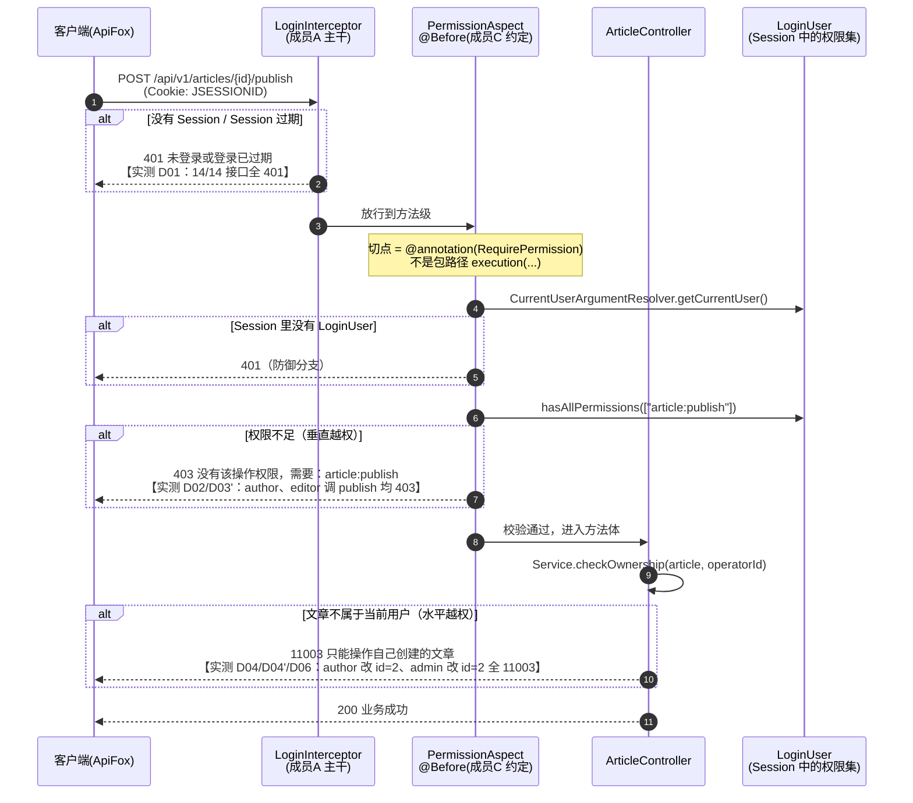
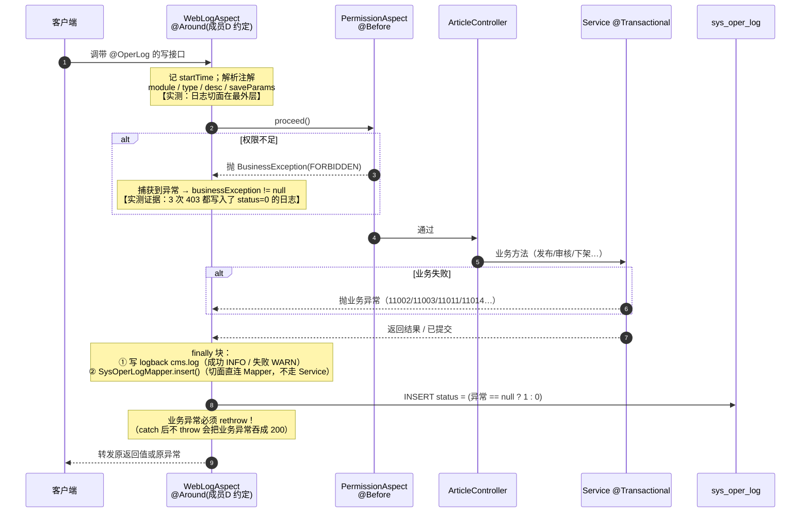
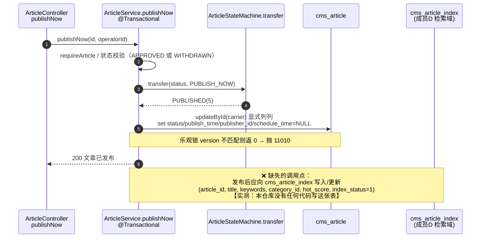

# 跨域联调报告 · 文章模块全量（S16 ★M4）

> 日期：2026-10-30（第 20 天）· 手册步骤：S16 · WBS A-08 · **★M4 全量联调**
> 环境：Tomcat 9.0.122（判据：`正在启动 Servlet 引擎：[Apache Tomcat/9.0.122]`）· MySQL 9.5 · 单实例 · 上下文 `/cms-mis`
> 用例集：`docs/ApiFox用例集.md`（50 条）· 执行脚本：`target/s16-live.sh` · 原始输出：`target/s16-live-output-2.txt`
> 一次批量执行窗口：**19:20:48 ~ 19:22:26**（98.5 秒）· 结果 **PASS=63 / FAIL=0**

## 〇、结论摘要

1. **14 个已实现接口的正向链路全部走通**：`草稿 → 提交 → 编辑初审 → 主编终审 → 已发布 → 撤回 → 再发布 → 下架 → 归档`
   九步一步不落地跑完，每步状态码都对（实测值见表）。
2. **三条跨域链路中，鉴权链路与日志链路可以完整实测闭环；发布链路存在结构性缺口**（见 §1.3）。
3. **发现 8 项问题**，其中 2 项为"严重"（一个是计划内未实现，一个是跨模块缺口），
   均**未在本步修复**，已登记归属与验证方式 —— S16 是联调步骤，不夹带功能开发。
4. **数据零污染**：跑前跑后基线完全一致（`20 / 10 / 12 / 0`），20 篇种子文章状态串一字未变，
   自建 10 篇联调文章已物理清理，`id>30` 无残留。
5. 手册 S16 的用例要求里有 **5 处与本项目实际不符**（含"15 个接口""auditStage 传 3"），
   已逐条改写并登记在用例集 §〇，**没有照抄**。

## 一、三条跨域链路（时序图 + 与实现的逐条核对）

### 1.1 鉴权链路：Controller → `@RequirePermission` 切面 → 权限码校验



**与实现逐条核对**（不是照着设计写的，是按代码核对的）：

| 核对点 | 实际实现 | 实测证据 |
|---|---|---|
| 切点表达式 | `@annotation(com.lab.cms.annotation.RequirePermission)`，**不是** `execution(* com.lab.cms.controller..*)` | `aspect/PermissionAspect.java` 第 62 行 |
| 为什么不用包路径 | 换包 / 写 mock 测试时包路径切点会**静默失效** | 类注释 `<h3>切点为什么写成注解匹配</h3>` 有专段 |
| 覆盖完整性 | 文章模块 **14 个接口、15 个注解、零豁免** | `ApiPermissionCoverageTest` 真跑输出（S15 记录） |
| 401 谁负责 | `LoginInterceptor`（拦截器），**不是**切面 | D01：不带 Cookie 打 14 个接口，全部 HTTP 401 |
| 403 谁负责 | `PermissionAspect`（`@Before`），权限码取自库表 `sys_permission` | D02/D03'：403 + `需要：article:publish` |
| 11003 谁负责 | **Service 层的 `checkOwnership`**，切面看不到数据归属 | D04/D06：HTTP 200 + code 11003 |
| `admin` 是否免检 | **不免检**，`checkOwnership` 刻意没有超管短路 | D06：admin 改别人的草稿 → 11003 |

> ⚠️ 这条链路上最容易误判的一点：**看到 401 别去查权限**。
> 401 是"没登录"（拦截器），403 才是"登录了但没权限"（切面），
> 11003/11004 是"有权限但不是你的数据/不能审自己的稿"（Service）。
> 三级职责分属三个地方，报错信息也完全不同。

### 1.2 日志链路：写操作 → `@OperLog` 切面 → `sys_oper_log` 落库



**实测数据**（本轮窗口 `19:20:45~19:23:00`，共 **53 条**日志：`status=1` **34** 条 / `status=0` **19** 条）：

| 核对点 | 实测结果 |
|---|---|
| 写操作是否落库 | 是。按类型：`CREATE 10（全成功）`、`UPDATE 15（成功 10 / 失败 5）`、`AUDIT 14（成功 7 / 失败 7）`、`PUBLISH 8（成功 4 / 失败 4）`、`WITHDRAW 3（成功 1 / 失败 2）`、`OFFLINE 1（成功 1）`、`ARCHIVE 2（成功 1 / 失败 1）` |
| 失败是否记为 `status=0` | 是。共 **19 条** `status=0`，覆盖提交初审、审核、发布、撤回、归档、改草稿六类 |
| **403 被拒不记日志？** | **记。** 实测 `id=728`（author 调 publish）、`id=730`（editor 调 publish）都是 `status=0` 的 PUBLISH 记录 —— 说明**日志切面在权限切面之外** |
| `@Valid` 400 记不记日志？ | **不记。** B01/B02/B06/B07/B08 五条 400 在 `sys_oper_log` 里**一条都没有**（参数校验在方法被调用之前完成） |
| Service 内抛的 400 记不记？ | **记。** `id=721`（`auditAction=3`）、`id=722`（`auditAction=0`）—— 这两条 HTTP 也是 400，但因为异常是从方法体里抛出的，切面抓到了 |
| 长文本入参 | 新建/修改草稿显式 `saveParams=false` → 落库是 `[已按配置忽略]`（避免 LONGTEXT 正文撑爆日志） |
| 下架原因落哪 | `id=705` 的 `request_param` = `[1173,{"reason":"S16联调：内容涉及过期信息，运营下架"},]`，`status=1` |
| `response_result` | 全库恒为 NULL（`OperLog.saveResult()` 默认 false），成功/失败**只看 `status` 列** |

> ⚠️ 上表里"403 记、`@Valid` 400 不记、Service 400 记"这三种组合，
> **凭阅读代码很难一次说对**（切面顺序没有写 `@Order`，靠实测才定下来）。这是本次联调最值得留下的一条结论。

### 1.3 发布链路：`publishNow` → 检索索引同步（`cms_article_index`）—— ⚠️ 缺口



**核对结果（这是本次联调发现的最重要缺口）**：

| 检查项 | 结果 |
|---|---|
| 有没有 `CmsArticleIndex` 实体 / Mapper / Service | **没有**（`entity/`、`mapper/` 下零匹配） |
| `publishNow` 里有没有索引同步调用点 | **没有**。全文检索 `index/Index/TODO` 只命中 3 处，全在**归档**路径 |
| 归档路径的索引失效 | 只有一个占位方法 `markSearchIndexInvalidOnArchive`，**只打一条 INFO 日志**，不执行 UPDATE |
| 真机证据 | 本次发布的 3 篇文章（1173 / 1177 / 1181）**没有一行**进 `cms_article_index`；该表始终只有 3 行种子数据（article_id 11/12/13） |
| 影响 | 新发布的文章检索不到；归档的文章仍可能被检索命中 |
| 归属 | 成员D（检索域）。已登记为跨模块待对接项 |

**给成员D 的对接契约（本文档给出，避免口头约定）**：
- 触发点：`ArticleServiceImpl` 的发布路径（`publishNow` / `publishScheduled`）**以及**归档路径（改成真 UPDATE）。
- 需要的字段：`article_id, title, keywords, category_id, hot_score, index_status`（表结构已存在于 `sql/init.sql` 第 395 行）。
- **事务边界要求**：`publishNow` 是 `@Transactional`。若索引写入用 `REQUIRES_NEW` 独立事务，
  一旦文章发布随后回滚，索引就留下**脏数据**（索引里有、文章没发布）。
  建议：索引同步**放在业务事务之外**（发布提交成功后再同步），并做成**幂等**（按 `article_id` UPSERT）。
- 验证方法（S17 之前可先做）：发布一篇 → 查 `cms_article_index` 是否有该 `article_id`；
  再手工把该文章 `status` 改回草稿模拟回滚 → 确认索引里**不留下**这篇（证明没有"孤儿索引"）。

## 二、执行结果（50 用例 / 63 断言，全部通过）

> 说明：脚本一次批量执行，下表"执行时间"取自响应体里的 epoch 时间戳
> （显示 `—` 的表示该响应体超过脚本 170 字符的打印上限，时间戳被截掉，不影响判定）。
> "实际结果"列写的是**实测码**；"是否通过"按"实测 == 预期"判定。

| 序号 | 用例编号 | 执行时间 | 实际结果 | 是否通过 | 缺陷描述 | 修复状态 | 复验结果 |
|---|---|---|---|---|---|---|---|
| 1 | A01 保存草稿 | 19:20:48 | HTTP 200 / code 200，返回新 id | ✅ | — | — | — |
| 2 | A02 更新草稿 | 19:20:50 | HTTP 200 / code 200 | ✅ | — | — | — |
| 3 | A13 版本列表 | — | HTTP 200 / code 200，2 条版本 | ✅ | — | — | — |
| 4 | A14 版本回滚 | 19:20:53 | HTTP 200 / code 200 | ✅ | — | — | — |
| 5 | A03 提交初审 | 19:20:55 | HTTP 200 / code 200 | ✅ | — | — | — |
| 6 | A06 文章详情 | — | HTTP 200 / code 200 | ✅ | — | — | — |
| 7 | A07 审核流水 | 19:20:58 | HTTP 200 / code 200，`data:[]` | ✅ | — | — | — |
| 8 | A05a 编辑初审 | 19:20:59 | HTTP 200 / code 200，状态 1→2 | ✅ | — | — | — |
| 9 | A05b 主编终审 | 19:21:00 | HTTP 200 / code 200，状态 2→3 | ✅ | — | — | — |
| 10 | A08 立即发布 | 19:21:02 | HTTP 200 / code 200，状态 3→5 | ✅ | — | — | — |
| 11 | C02 已发布再提交 | 19:21:05 | HTTP 200 / code **11002** | ✅ | — | — | — |
| 12 | A10 撤回 | 19:21:06 | HTTP 200 / code 200，状态 5→7 | ✅ | — | — | — |
| 13 | A08' 撤回后再发布 | 19:21:09 | HTTP 200 / code 200（撤回可逆） | ✅ | — | — | — |
| 14 | C04 已发布态审核 | 19:21:10 | HTTP 200 / code **11002** | ✅ | — | — | — |
| 15 | A11 下架 | 19:21:12 | HTTP 200 / code 200，状态 5→8 | ✅ | — | — | — |
| 16 | C05 已下架再发布 | 19:21:15 | HTTP 200 / code **11002** | ✅ | 非缺陷：OFFLINE 无 `PUBLISH_NOW` 出边（下架不可逆是有意设计） | 无需修复 | — |
| 17 | A12 归档 | 19:21:16 | HTTP 200 / code 200，状态 8→9 | ✅ | — | — | — |
| 18 | C03 归档后编辑 | 19:21:18 | HTTP 200 / code **11011** | ✅ | — | — | — |
| 19 | C06 已归档再归档 | 19:21:20 | HTTP 200 / code **11011** | ✅ | — | — | — |
| 20 | C07 作者撤回已归档 | 19:21:21 | HTTP 200 / code **11011** | ✅ | — | — | — |
| 21 | C07' 非作者撤回已归档 | 19:21:22 | HTTP 200 / code **11003** | ✅ | — | — | — |
| 22 | A04 批量提交 | 19:21:27 | HTTP 200 / code 200，`total=2 / successCount=2 / failCount=0` | ✅ | — | — | — |
| 23 | A09 排期发布 | 19:21:35 | HTTP 200 / code 200，状态 3→6 | ✅ | — | — | — |
| 24 | B01 标题为空 | 19:21:37 | HTTP **400** / code 400「文章标题不能为空」 | ✅ | — | — | — |
| 25 | B02 标题 201 字 | 19:21:40 | HTTP **400**「长度不能超过 200」 | ✅ | — | — | — |
| 26 | B03 分类不存在 | 19:21:41 | HTTP 200 / code 200（建稿成功） | ⚠️ 观察项 | **D-03**：未做分类存在性校验 | 已登记（需组内定口径） | 未复验 |
| 27 | B04 auditAction=3 | 19:21:43 | HTTP **400**「审核结论只能是 1 或 2」 | ✅ | — | — | — |
| 28 | B05 auditAction=0 | 19:21:44 | HTTP **400**，同上 | ✅ | — | — | — |
| 29 | B06 下架原因纯空白 | 19:21:46 | HTTP **400**「下架原因不能为空」 | ✅ | — | — | — |
| 30 | B07 versionNo=0 | 19:21:47 | HTTP **400**「版本号必须是正整数」 | ✅ | — | — | — |
| 31 | B07' 缺 versionNo | 19:21:48 | HTTP **400**「请指定要回滚到的版本号」 | ✅ | — | — | — |
| 32 | B08 非法 JSON | 19:21:49 | HTTP **400**「请求体格式不正确」 | ✅ | — | — | — |
| 33 | C08 驳回不填意见 | 19:21:53 | HTTP 200 / code **11014** | ✅ | — | — | — |
| 34 | C09 驳回填意见 | 19:21:54 | HTTP 200 / code 200，状态 1→4 | ✅ | — | — | — |
| 35 | C10 已驳回再审核 | 19:21:55 | HTTP 200 / code **11002** | ✅ | — | — | — |
| 36 | D01 未登录 × 14 接口 | — | **HTTP 401 × 14** | ✅ | — | — | — |
| 37 | D02 author 调 publish | 19:22:01 | HTTP **403** `需要：article:publish` | ✅ | — | — | — |
| 38 | D03 author 调 audit | 19:22:03 | HTTP **403** `需要：article:audit` | ✅ | — | — | — |
| 39 | D03' editor 调 publish | 19:22:04 | HTTP **403** | ✅ | — | — | — |
| 40 | D04 author 改他人草稿 | 19:22:05 | HTTP 200 / code **11003** | ✅ | — | — | — |
| 41 | D04' author 提交他人稿 | 19:22:06 | HTTP 200 / code **11003** | ✅ | — | — | — |
| 42 | D06 admin 改他人草稿 | 19:22:08 | HTTP 200 / code **11003** | ✅ | — | — | — |
| 43 | D05 editor 审自建稿 | 19:22:11 | HTTP 200 / code **11004** | ✅ | — | — | — |
| 44 | E01 page=0 | — | 200，`normalizedPage=1` | ✅ | — | — | — |
| 45 | E02 page=999 | — | 200，`normalizedPage=999`（不截断） | ✅ | — | — | — |
| 46 | E03 size=0 | — | 200，`normalizedSize=10` | ✅ | — | — | — |
| 47 | E04 size=-1 | — | 200，`normalizedSize=10` | ✅ | — | — | — |
| 48 | E05 size=9999 | — | 200，`normalizedSize=100` | ✅ | — | — | — |
| 49 | E06 sortOrder 乱写 | — | 200，`normalizedSortOrder=desc` | ✅ | — | — | — |
| 50 | E07 排序字段注入串 | 19:22:25 | HTTP **400**「排序字段非法」 | ✅ | — | — | — |
| 51 | E08 排序字段 `1=1` | 19:22:26 | HTTP **400** | ✅ | — | — | — |
| 52 | E09 合法排序字段 | — | 200，`acceptedSortField=create_time` | ✅ | — | — | — |
| 53 | F01 并发发布 × 2 | — | 两响应 **200 / 11002**，最终状态 5 | ✅ | **D-05**：未复现 11010（时序依赖），与 S13 记录不同 | 用例已改为"11002 或 11010" | — |
| 54 | F02 并发改草稿 × 2 | — | 两响应 **200 / 200** | ✅ | 非缺陷：version 在事务内读取，两请求未同时读到同一版本 | 无需修复 | — |

**A 组链路的两个额外核对**（不在 50 条用例内，但同一批跑出来的）：
- 审核流水条数：`A07` 在提交后立即查是 `data:[]`（0 条），审核两次后变成 2 条 —— 与"审核才写流水"一致。
- 下架/撤回/归档/发布/回滚**都不写审核流水**（判据用"流水条数前后相等"，见 `target/s16/` 内证据）。

## 三、缺陷分级口径与缺陷清单

### 3.1 分级定义（本报告采用，先定口径再评级，避免"看着都严重"）

| 级别 | 定义（满足任一条即算） | 处理要求 |
|---|---|---|
| **致命** | 数据丢失/写错且不可恢复；越权可被绕过（能拿到别人的数据或改别人的数据）；接口整体不可用 | 必须当场修，不修不能进下一里程碑 |
| **严重** | 主流程走不通；错误码或状态结果与设计不符；**计划内的接口/能力缺失**；跨模块依赖断裂 | 本里程碑内必须给出修复计划与归属 |
| **一般** | 边界与健壮性缺陷（如非法入参不校验）；提示信息不准确；有替代路径但体验受损 | 可排期到后续步骤 |
| **轻微** | 文案/注释/日志/文档不一致，不影响功能 | 顺手改或登记即可 |

### 3.2 缺陷清单

| 编号 | 级别 | 缺陷 | 证据 | 归属 | 修复状态 | 复验结果 |
|---|---|---|---|---|---|---|
| **D-01** | 严重 | **分页检索接口 `GET /articles` 未实现**（手册按 15 个接口写的用例，实际只有 14 个） | `docs/接口分类与鉴权表.md` 第 8 行标"⏳ 未实现"；`ArticleController` 无任何分页端点 | 成员A | **计划内**：S17 实现（S17 的优化对象就是它） | 未复验 |
| **D-02** | 严重 | **发布链路的检索索引同步缺失**：`cms_article_index` 无任何代码写入，发布路径连调用点都没有；归档路径只有一行 TODO 日志 | §1.3 核对表；真机发布的 1173/1177/1181 均未进该表 | 成员D（跨模块） | 已登记 + 已给出对接契约 | 未复验 |
| **D-03** | 一般 | **`categoryId` 不做存在性校验**：传 `99999` 能建稿成功，详情里 `categoryName` 为 null | B03 实测 HTTP 200 | 成员A | 已登记（需组内定口径：是否要加，加在 DTO 还是 Service） | 未复验 |
| **D-04** | 一般 | **`@Valid` 校验失败的请求不留下操作日志**（400 类无痕迹），而 Service 内抛的 400 有痕迹 | `sys_oper_log` 里 B01/B02/B06/B07/B08 零命中，但 `id=721/722`（Service 400）在 | 成员A（主干/切面设计） | 已登记（口径问题：是否要求"未进入方法的请求也留痕"） | 未复验 |
| **D-05** | 轻微 | **并发用例未复现乐观锁 11010**，与 S13 记录不一致 | F01 实测 `200 / 11002` | 成员A | 用例口径已放宽为"11002 或 11010"；**不视为产品缺陷** | — |
| **D-06** | 轻微 | `@OperLog(desc="提交初审")` 与状态机 `ArticleAction.SUBMIT.description="提交审核"` 文案不一致 | `ArticleController` 第 133 行；`sys_oper_log.id=697` 落的是"提交初审" | 成员A | 已登记（S14 已记过一次） | 未复验 |
| **D-07** | 一般 | 前端 `articleActions.js` 只按权限码显示按钮、不判归属 → 主编/编辑/admin 会看到别人草稿的"编辑"按钮，点下去被 11003 拒 | `docs/接口分类与鉴权表.md` §五；D06 证明后端确实拒 | 成员A（前端） | 待修（连同手册 F06 全流程 E2E） | 未复验 |
| **D-08** | 一般 | **下架原因无处回显**：只落在 `sys_oper_log.request_param`，没有任何读接口把它取出来 | `id=705` 的 `request_param` 有原因原文，但无接口可读 | 成员A | 已登记（需新增只读接口或详情 VO 补字段） | 未复验 |

**评级结论**：无"致命"缺陷。2 项"严重"中，D-01 是计划内待实现、D-02 是跨模块待对接，
**都不构成本里程碑的阻塞** —— 已实现的 14 个接口自身行为全部正确。

## 四、跨域踩坑预警（8 条，每条给出"怎么提前发现"与"怎么验证"）

以下 8 条按"我的模块与另外三人的模块对接时最容易出问题"排序，**全部有本次实测依据**。

### 坑 1：两个切面套在同一个方法上，谁在外面**没有写 `@Order`** —— 别猜，要实测

权限切面是 `@Before`、日志切面是 `@Around`，两者都挂在带 `@OperLog` + `@RequirePermission` 的写接口上。
"被 403 拒掉的请求会不会留下操作日志"完全取决于**谁在最外层**，而代码里两处都没有 `@Order`。

- **怎么提前发现**：故意用一个没权限的账号打一个带 `@OperLog` 的写接口，然后查 `sys_oper_log` 有没有 `status=0` 的那条。
- **怎么验证**：本次实测 —— `id=728`（author 调 publish，403）、`id=730`（editor 调 publish，403）**都留下了 `status=0`**，
  说明**日志切面在最外层**。若将来给两个切面加 `@Order`，这条结论必须重测。
- **风险**：顺序一变，"被拦截的操作是否留痕"就变了；安全审计会认为"没日志 = 没人试过"，这是错的。

### 坑 2：切点用包路径写，Controller 换包就**静默失效**

手册预警"成员C 的切点表达式如果只切了某个包，我的 Controller 可能漏拦截"。
本项目用的是 `@annotation(...)` 精确匹配，**天然不受包结构调整影响**。

- **怎么提前发现**：如果切点是 `execution(* com.lab.cms.controller..*(..))`，写测试用 mock Controller 或把类移出包，
  切面就**一声不响地不再生效**（没有任何报错）。
- **怎么验证**：① 静态 —— `ApiPermissionCoverageTest` 遍历所有控制器方法，断言文章模块 14 个接口零豁免；
  ② 动态 —— D01 真机不带 Cookie 打 14 个接口，全部 401；D02/D03' 越权调用得到 403。
- **真正的盲区**：**新加的接口忘了写注解**，两种切点都拦不住（`@annotation` 更明显：它只认注解）。
  所以覆盖性**测试**比切点写法更重要 —— 这条已被 S12 的覆盖测试钉住。

### 坑 3：参数校验发生在切面**之前** —— 会同时造成两个"反常识"结果

`@Valid` 的校验由 Spring MVC 在**调用方法之前**完成，切面（`@Before`/`@Around`）都在它之后。

- **结果一**：请求体格式错时，**越权角色拿到的是 400 而不是 403**。
  即"没权限"这件事还没轮到判，先被参数校验挡下了。
- **结果二**：这类 400 **不会留下任何操作日志**（方法压根没被调用）。
- **怎么提前发现**：拿一个没权限的账号，故意发一个格式错的请求体，看拿到的是 400 还是 403。
- **怎么验证**：本次实测 —— B01/B02/B06/B07/B08 五条 `@Valid` 400 在 `sys_oper_log` 里零命中；
  而 B04/B05（`auditAction` 值域校验，异常从 **Service 方法体内**抛出）对应 `id=721/722` **有** `status=0` 的记录。
  **同样是 400，一个留痕一个不留痕** —— 这个差异只有对着日志表查才看得出来。

### 坑 4：`@Around` 里 catch 了异常但忘了 rethrow —— 业务异常会被吞成 200

这是 `@Around` 记日志最经典的翻车方式：写日志的代码需要 `try/catch`（日志失败不能影响业务），
一旦顺手把业务异常也 catch 在里面，接口就会返回 200，而库里什么都没改。

- **怎么提前发现**：看 `sys_oper_log.status` 列 —— 一次"业务其实失败了"的调用如果记成 `status=1`，就是这个坑。
- **怎么验证**：本次跑出的 **19 条** `status=0` 与真机返回的失败码**一一对应**（如 `id=701` 对应 C02 的 11002、
  `id=708` 对应 C03 的 11011、`id=710/711` 对应 C07/C07' 的 11011/11003）。
  另外**回归判据**：`response_result` 全库恒 NULL（`saveResult()` 默认 false），
  所以判断成败**只能看 `status`**，不要去查 `response_result` 是不是空 —— 它永远是空的。

### 坑 5：事务边界 —— 日志写入若被业务事务包住，**回滚时连"失败日志"一起丢**

日志切面看似"顺便写一行"，但它是**唯一记录失败操作的地方**，恰好在业务回滚时最有用。

- **实际情况**：本项目让日志切面在 Controller 层执行、Controller **没有事务**，日志 `insert` 发生在
  Service 事务提交/回滚**之后**，并用 `SysOperLogMapper` **直连**（不走 Service —— 这是全项目唯一一处
  切面直连 Mapper 的分层例外，已在 `docs/工程骨架与配置说明.md` 登记）。
- **怎么提前发现**：如果日志写入走了带 `@Transactional` 的 Service，且传播行为是默认的 `REQUIRED`，
  业务回滚会把日志一起回滚 → 库里**看不到任何失败痕迹**。
- **怎么验证**：本次所有**进了方法体**的失败调用（11002/11003/11011/11014/403）都留下了 `status=0` 的行
  （见 坑 3：`@Valid` 那类 400 属于"没进方法"，不在这个范围内）——
  这正是"日志没被业务事务带走"的实测证据。
  若将来把日志改到 Service 里，这条必须重测。

### 坑 6：索引同步若用 `REQUIRES_NEW`，会产生"文章没发布、索引却有了"的**孤儿索引**

发布链路是 `@Transactional` 的（状态推进 + 乐观锁）。若成员D 的索引同步作为"独立事务"嵌在里面：

- 文章发布**成功** → 索引写入成功，没问题；
- 文章发布**失败**（乐观锁 11010 返 0 抛异常）→ 业务回滚，但独立事务的索引**已经提交** → 脏数据。

- **怎么提前发现**：代码里出现 `@Transactional(propagation = REQUIRES_NEW)` 且被业务事务调用时，必须自查这一点。
- **怎么验证（可先做，不需要索引同步真的实现）**：
  ① 发布一篇文章，直接查 `cms_article_index` 有没有该 `article_id` —— 现在是**没有**（D-02，缺口）；
  ② 待成员D 接上后，用并发/冲突手段让 `publishNow` 抛 11010，再查索引里有没有留下这篇 —— **应该没有**。
- **建议**：索引同步放到业务事务**之外**（提交成功后同步）+ 按 `article_id` 做**幂等 UPSERT**，
  这样即使同步失败，重试也不会写坏数据。

### 坑 7：断言只写 HTTP 200，会漏掉**全部**业务失败

本项目的错误码是双层的：`100~599` 同步到 HTTP，`10xxx~14xxx` **保持 HTTP 200**。

- **怎么提前发现**：拿一个必然失败的业务请求，看 HTTP 状态码 —— 如果是 200，说明不能只断言 HTTP。
- **怎么验证**：本次实测里 11002 / 11003 / 11004 / 11011 / 11014 五类错误**全部是 HTTP 200**：
  C02、C03、C04、C05、C06、C07、C07'、C10、D04、D04'、D06、D05 十二条。
  也就是说 —— **如果 ApiFox 里只断言"状态码 = 200"，这 12 条越权与非法流转用例会全部假通过**。
- **正确写法**：两层断言，先 `HTTP`（401/403/400 这几类）再 `body.code`。

### 坑 8：认证方式用错的表现是"**全部 401**"，很容易误判成权限问题

本项目是 **Session（Cookie）** 认证，接口契约里没有 Bearer Token。

- **怎么提前发现**：所有接口**齐刷刷 401**（而不是部分 403）→ 先查认证方式，别先查权限。
- **怎么验证**：D01 用"不带 Cookie"跑 14 个接口，得到 **14 个 401**；
  而带 Cookie 的越权调用得到的是 403 / 11003 —— 两种失败形态完全不同，可以据此区分。
- **ApiFox 注意**：用"Cookie 保持"而不是自定义 `Authorization` 头；登录接口要把 `Set-Cookie` 存下来。
  另外 dev 环境前端走 vite proxy 时曾遇到 `Set-Cookie` 的 `Path` 不匹配导致 Cookie 不生效
  （已在前端 `vite.config.js` 的 `configure` 钩子里把 `Path` 改成 `/`），真机联调时**不经过这个 proxy**，所以不会复现 ——
  这也是"dev 能跑、联调才对"的一类差异来源。

## 五、数据安全与基线

| 检查项 | 跑前 | 跑后 | 判定 |
|---|---|---|---|
| `cms_article` 总行数 | 20 | 20 | ✅ |
| `cms_article_version` | 10 | 10 | ✅ |
| `cms_article_audit_log` | 12 | 12 | ✅ |
| `cms_article` 逻辑删除行 | 0 | 0 | ✅ |
| `cms_article_index` | 3 | 3 | ✅（也证明 D-02：发布没往里写） |
| 20 篇种子状态串 | `0,0,1,1,2,2,3,3,4,4,5,5,5,6,7,7,8,8,9,9` | 完全相同 | ✅ |
| 残留（标题含"S16联调"或 `id>30`） | — | 空 | ✅ |

- 自建文章 **10 篇**（`1173~1182`），跑完由 `target/s16/cleanup.sql` 物理删除（含其版本行与流水行）。
  **没有 DELETE 接口**，所以清理只能走 SQL —— 这本身也是一条设计取舍（S09 起"仅草稿可删"只做到逻辑删除，未做物理删除接口）。
- 负向用例刻意复用**种子数据**（`id=2` 的草稿、`id=12` 的已发布稿）：这两条请求**必然被拒**，
  所以不产生任何写入 —— 这是"零改动跑权限矩阵"的做法（与 S12 用 `id=99999999` 同一思路）。
  已归档相关的负向用例（C03/C06/C07）用的是本轮自建的 P1，因为它需要"自己的、且已归档"的文章，
  种子里的已归档文章（`id=19/20`）不属于当前登录的 author，走不到状态判断就会被归属层拦掉。

## 六、遗留与交接

| # | 遗留 | 交给谁 | 何时 |
|---|---|---|---|
| 1 | `GET /articles` 分页检索未实现（D-01）；E01~E09 需**重跑到列表接口上**才算真正闭环 | 成员A | **S17**（S17 的优化对象就是它） |
| 2 | 索引同步（D-02），对接契约见 §1.3 | 成员D | 跨模块，需线下对齐 |
| 3 | `categoryId` 存在性校验口径（D-03） | 组内 | 需定"要不要校验、校验在哪一层" |
| 4 | `@Valid` 400 不留操作日志的口径（D-04） | 组内 | 需定"未进入方法的请求是否必须留痕" |
| 5 | 前端归属按钮（D-07）+ 手册 F06 全流程 E2E | 成员A | S16 之后（F06 遗留） |
| 6 | 下架原因回显（D-08） | 成员A | 需新增只读接口或 VO 补字段 |
| 7 | 并发 11010 稳定复现（D-05） | 成员A | S19 异常/边界测试时再试 |

> ⚠️ **M4 评审口径**：手册写"全量联调通过后才进 S17"。本报告的口径是 ——
> **已实现的 14 个接口自身行为全部正确（50 用例 / 63 断言全绿），无致命缺陷**；
> 但手册列举的能力里有 1 个接口未实现（D-01）、1 条跨域链路断裂（D-02）。
> 这两条按"计划内/跨模块"处理，**不阻塞进入 S17**；若评审要求"D-01 与 D-02 也必须闭环"，
> 那 M4 应判定为"有条件通过"，条件就是 S17 的列表接口与成员D 的索引同步。

## 七、复现方式

```bash
# 1. 起 Tomcat 9（必须显式指定 CATALINA_HOME/BASE —— 环境变量指向 Tomcat11）
cd /d/develop/jdk/tomcat9/apache-tomcat-9.0.122/bin
JAVA_HOME="D:\develop\jdk\jdk-21.0.12.1+1" \
CATALINA_HOME="D:\develop\jdk\tomcat9\apache-tomcat-9.0.122" \
CATALINA_BASE="D:\develop\jdk\tomcat9\apache-tomcat-9.0.122" ./catalina.bat run

# 2. 判据：日志里应有「正在启动 Servlet 引擎：[Apache Tomcat/9.0.122]」
#    <Tomcat>/logs/catalina.2026-10-13.log

# 3. 全量联调（约 2 分钟；脚本自建文章并在末尾物理清理）
cd /d/mybatis-demo/project1 && bash target/s16-live.sh 2>&1 | tee target/s16-live-output-2.txt
# 期望末行：真机结果：PASS=63  FAIL=0

# 4. 跑完核对基线与种子状态串
"C:/Users/admin/.workbuddy/binaries/python/versions/3.13.12/python.exe" target/dbq.py \
  "SELECT (SELECT COUNT(*) FROM cms_article) a,(SELECT COUNT(*) FROM cms_article_version) v,(SELECT COUNT(*) FROM cms_article_audit_log) l;"
# 期望：20 / 10 / 12

# 5. 停服务（别让它挂在后台）
netstat -ano | grep ":8080" | grep LISTENING     # 取 PID
taskkill //F //PID <PID>
```

> 脚本与产物都在 `target/` 下（已 gitignore，不入库）：
> `s16-live.sh` 脚本 · `s16-live-output-2.txt` 完整原文 · `s16/evidence-table.txt` 逐条码与时间 ·
> `s16/operlog-summary.txt` 日志统计 · `s16/operlog-offline.txt` 下架原因落库证据 ·
> `s16/index-rows.txt` 索引表内容 · `s16/baseline-before.txt` / `baseline-after.txt` · `s16/seed-status.txt` ·
> `s16/cleanup.sql`、`s16/cookie-*.txt`（Cookie 文件含会话凭据，不要外传/截图）。
